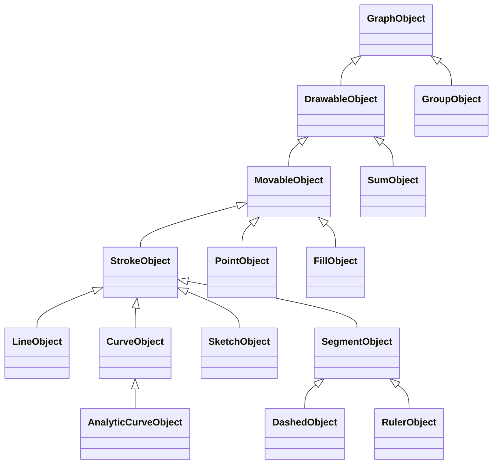

# 구현 구조

## Shift 방향 잠금의 접선 후보 · 2026-11-08

직선 도구의 Shift를 "가까운 방향으로 잠금"으로 넓혔습니다. 새 도형·관계·버튼·저장 필드는 없습니다.

- `TwoPointCreation.pointerDown`이 첫 점의 공통 맞춤(`ctx.segmentSnap`)이 있을 때 `startTangents`로 그 점을 지나는 모든 곡선(`curves`·`sketches`)의 접선을 구해 초안(`draft.tangents`)에 둡니다. 맞춤은 겹친 대상 중 하나(끝점·접점 등)만 알려 주므로 곡선은 위치로 찾습니다.
- `curve-contacts.js`의 `curveTangentsAt(state,bounds,point,ids)`: 해석 곡선은 종류 클래스의 `nearestPoint`로 곡선 위인지 확인하고 `tangentVector`를 씁니다(`contactGeometry:'kink'`는 제외). 자유·기본 곡선은 `contactBranches`의 이차/직선 구간에 추가한 `tangentAt`(최근접 거리와 방향)으로 가장 가까운 구간을 고릅니다. 평행한 접선은 ids를 합쳐 하나로 반환합니다.
- `ruler.js`의 `directionLock(anchor,point,tangents)`이 수평·수직·접선 중 anchor→포인터 방향과 가장 가까운 것을 고릅니다. 접선이 없으면 이전 규칙(|dx|≥|dy|이면 수평)과 같습니다. `alongDirection`은 포인터를 잠긴 방향 위로 투영하고 보이는 범위 안에 둡니다(수직이면 x를 정확히 유지).
- 접선으로 잠기면 `ctx.segmentPosition(point,event,null,guide)`가 canvas의 `segmentOptions`에 `guide`를 넘겨 직선 끝 손잡이와 같은 `guideSnapCandidates` 경로로 접선 위 대상에 붙습니다. 붙을 곳이 없을 때는 `draft.lock`(접점·`kind:'tangent'`·`label:'접선 맞춤'`·곡선 ids)을 `feedback()`이 공통 표시에 넘깁니다. Alt는 접선 후보를 뺍니다.
- 검사: `tests/line-tool.test.js`(방향 선택·투영·곡선 접선·포인터 흐름), `tests/browser/contact-tangent-line.html`(접점 사례 세 종류 × 두 크기 × 축 반전, 단일 PPC).

## 두 점 직선 도구 · 2026-11-08

`TOOL_MODES.line`(`lineSelected`)이 생성 도구로 등록됐습니다. 점선 도구의 포인터 흐름을 `creation-tools.js`의 `TwoPointCreation`으로 올리고 `DashedCreation`과 `LineCreation`이 상속합니다. 두 도구는 클릭·클릭/드래그, Shift 축 고정, canvas의 `dashedPosition`(공통 `snapDashedPoint`와 `dashedSnap` 토글)을 공유하며 방향 모드·기존 도형 누르기·미리보기·결과만 다릅니다. 직선 도구는 기존 직선을 눌러도 잡지 않고 그 위치에서 그리기를 시작합니다.

- 기하: `line-extent.js`의 `lineFromPoints(from,to,kind)`가 첫 점을 기준점으로 기울기(`slopeThrough`, x가 같으면 null)와 extent를 만듭니다. 종류는 저장하지 않고 extent에서 `lineKindOf`로 읽습니다. `extentForKind`는 선택한 직선의 종류 변경에서 있는 끝을 유지하고 없는 끝을 보이는 부분(`visibleLineEnds(...).edge`) 안에 둡니다.
- 상태: `lineKind`·`lineStyle`은 도구 설정이며 문서·기록에 들어가지 않습니다. `addLine(from,to,{kind,style})`은 두 점이 있을 때만 새 경로를 쓰고 인자 없는 호출은 이전 기본 직선을 유지합니다. 직선 도구 중에 추가한 직선은 선택하지 않고 도구를 유지합니다.
- UI: `main.js`의 `lineShapeControls()`가 도구 패널(`#line-options`)과 선택 설정(`#line-shape-selected`)에 같은 버튼을 만들고 `tools/line.js`의 `mountShapeButtons`가 연결합니다. 선택 설정의 보이는 범위는 활성 그래프 컨테이너 크기로 `createViewport`를 다시 계산해 얻습니다.
- 각 그래프의 범위 제한 store(`workspace.js`)에 `addLine`을 추가했습니다.
- 같은 날 두 번째 변경: 툴바 점선 버튼·패널과 `tools/dashed.js`를 삭제했습니다. 세 번째 변경에서 내부 점선 도형·모드도 모두 제거했습니다(아래). 직선 끝 손잡이는 그려진 끝에만 렌더링하고(`editing-handles.js`), `LineInteraction.canDrag`가 열린 끝을 거절하며, `dragEnd`/키보드는 끝을 보이는 범위 안에 고정하고 가장자리에서 다시 열지 않습니다(`LINE_EDGE_PX` 삭제).
- 세 번째 변경(2026-11-08): `dashed` 도형·모드·`DashedCreation`·`DashedInteraction`·`snapMovingDashed`·`dashed-view.js`를 삭제하고 JSON을 schemaVersion 12로 올렸습니다(`dashedLines` 없음). `dashed-magnets.js`는 `segment-magnets.js`로, `snapDashedPoint`/`dashedSnap`/`dashedPosition`은 `snapSegmentPoint`/`segmentSnap`/`segmentPosition`으로 이름을 바꿨습니다. 선분·반직선 전체 이동은 `intercepts.js`의 `snapLineEnds`가 `snapMovingEnds`로 그려진 끝을 공통 대상(`ctx.snapTargets()`, 자기·종속 제외)에 맞추고 `chooseShapeMagnet`에서 직선 자석과 경쟁합니다(`LineInteraction.snap`이 잘린 직선일 때만 대상을 넘김). `buildSnapTargets`는 선분 끝과 자유 곡선 시작·끝을 계산한 교점 뒤에 `endpoint`로 등록하고, 같은 획이 걸린 교점·접점이 이미 있으면 등록하지 않습니다. `guideSnapCandidates`는 등록된 대상과 같은 위치의 계산 교차를 추가하지 않습니다. 공통 계약 브라우저 검사(`contact-contract.html` 등)는 직선 도구 선분으로 옮겼습니다.
- 생성 후 도구 복귀: store의 `add()`가 모든 생성 결과에 대해 `enterToolMode('hand')` 후 결과를 선택합니다. 기존 칠하기 재클릭(`addFill`)과 `duplicateSelected`도 같습니다. 도구 설정(`lineKind`·`lineStyle`·칠하기 색 등)은 유지합니다.

## 직선 끝 자르기·점선 스타일 · 2026-11-07

직선은 선택적 `extent:[from,to]`(기준점에서 `directionOf(slope)` 방향 거리, null은 열린 끝)와 `style`을 가집니다. `math.js`의 `clipLineParameters`/`clipLine`이 extent를 반영하므로 `displayedLineSegments`를 쓰는 렌더링·클릭 영역·맞춤 대상·칠하기 경계·절편 대상이 자동으로 잘린 부분만 사용합니다. 계산은 `graph/line-extent.js`(`onLineExtent`, `rebasedExtent`, `rotatedExtent`, `visibleLineEnds`, `lineEndPoints`)에 모았습니다.

- 모델: `LineObject.updateGeometry`는 anchor 변경을 평행이동으로 보고 extent를 유지합니다. extent 없이 기울기만 바뀌면 이전 방향과의 내적으로 끝의 방향을 이어 갑니다(키보드·슬라이더의 수직 경계 통과).
- 상호작용: `ShapeInteraction.startPatch`가 드래그 시작 편집과 스냅숏을 함께 정합니다. 직선은 같은 직선 위로 기준점을 옮길 때 `rebasedExtent`를 함께 보냅니다. 점을 따라가는 직선은 그 점을 회전 중심으로 유지합니다. 회전은 잡은 손잡이 쪽 반이 포인터를 따라가도록 `rotatedExtent`를 계산합니다. `line-from`/`line-to` 손잡이는 `snapDashedPoint(..., {guide})`를 사용합니다.
- 기존 직선 자석(`snapLineToIntercept`, `snapLineToTangency`, `snapShapeToPoint`, `snapCurveToTangency`, `snapSketchTangent`)은 `onLineExtent`로 그린 부분 밖의 후보를 버립니다. `sumError`는 끝을 자른 직선을 거절합니다.

검사는 `tests/line-extent.test.js`, `tests/browser/line-extent.html`, `suite.js`의 직선 설정 점선 토글에 있습니다.

## 접점 통과 직선 · 2026-11-07

곡선-곡선 접점 대상(`buildCurveContactTargets`)이 원래 기하에서 구한 공통 접선 방향을 `contactTangent`로 함께 담습니다. `curve-contacts.js`의 `contactTangentsAt(crossings, point)`와 `contactTangentSlope(state, bounds, point)`가 이 값을 읽는 유일한 경로입니다. `tools/sketch.js`의 **이 점을 지나는 직선**은 선택한 점이 접점이면 그 기울기를 `lineThroughSelectedPoint({slope})`에 넘기고, 아니면 기존 기본값을 씁니다. `LineInteraction.rotationCandidates`는 에지워드 원점 후보와 회전 중심에 있는 접점의 접선 후보를 한 목록으로 모아 `chooseSnapCandidate`로 고릅니다. 회전 중 대상은 canvas의 공유 `SnapTargetCache`(`ctx.snapTargets`)에서 받습니다. 직선은 기존 `through-point` 관계로 점만 따라가며 새 관계·객체 종류는 없습니다. 꺾임(`contactGeometry:'kink'`)은 접점 대상이 아니므로 자동으로 제외됩니다. 검사는 `tests/contact-tangent-line.test.js`, `tests/browser/contact-tangent-line.html`, `suite.js`의 실제 버튼 검사에 있습니다.

## 최저점 맞춤 · 2026-11-07

`sketch.js`의 `displayedSketchMinimum(curve, bounds, state)`가 최저점 표시 여부·위치·가시성을 한 번에 판단합니다. canvas의 마커와 `buildSnapTargets`가 같은 함수를 사용하며, 표시 중인 최저점은 꺾임과 같은 방식으로 `crossings`에 `kind:'minimum'`, `label:'최저점 맞춤'` 후보로 등록됩니다. 따라서 점 생성/이동, 점선 생성/끝점/전체 이동, 세 점 곡선의 시작/끝점이 같은 대상·16/24px·Alt·공통 표시를 사용합니다. 곡선 자신을 편집하는 동안에는 `independentSnapState`가 자신의 최저점을 제외하고, `showMinimum`이 곡선 데이터에 있으므로 `geometryKey` 캐시도 표시 전환에 맞춰 갱신됩니다. 점이나 관계를 만들지 않습니다. 검사는 `tests/minimum-snap.test.js`와 `tests/browser/edgeworth-minimum.html`에 있습니다.

## 반대 방향 무차별곡선·생성 도구 등록부 · 2026-11-07

**반대 방향 곡선**: `curve-families.js`의 `OppositeCurveFamily`가 `OPPOSITE_CURVE_FAMILIES`(콥더글라스·완전대체재·완전보완재·준선형)를 감쌉니다. `curveFamilyOf`는 `orientation:'opposite'`와 유효한 `oppositeOrigin`이 있으면 이 래퍼를 돌려주므로 모든 소비 경로(표시·자석·접점·칠하기·이동·복제·JSON)가 같은 계산을 사용합니다. 래퍼는 `AnalyticCurveFamily`의 모든 메서드를 대칭 변환해 위임합니다. 빠진 메서드가 원래 방향 계산으로 조용히 처리되지 않도록 `opposite-curves.test.js`가 메서드 목록을 비교합니다. 반경 이동의 중심은 새 `scaleCenter(c)`로 노출되며 `curve-curve-tangency.js`의 반경 맞춤이 이를 사용합니다. 방향 전환은 `orientCurve`, 반대 원점 이동은 `AnalyticCurveObject.updateGeometry`의 `oppositeOrigin` patch, 상자 총량 변경 시 따라가기는 `axes.js`의 `followBoxOrigin`이 담당합니다. 공통 접점·점선 사례(`curve-contact-cases.js`, `dashed-curve-cases.js`)는 반대 방향 family마다 사례를 요구합니다.

**생성 도구 등록부**: 점·점선·곡선·칠하기의 포인터 처리를 `graph/creation-tools.js`의 `CreationTool` 하위 클래스로 옮겼습니다. 각 도구는 `pointerDown`/`pointerMove`/`pointerEnd`/`clearHover`/`sync`/`draw`/`feedback`을 구현하고, canvas는 도구별 세션 하나와 공통 맞춤 상태·기록·렌더링만 관리합니다. 초안 레이어는 `slot`(fills·sketches·dashed)으로 기존 SVG 순서를 유지합니다. `assertCreationTools`는 `TOOL_MODES`에서 `kind:'creation'`인 모든 모드가 컨트롤러를 등록했는지, 초안 레이어가 있으면 그리기를 구현했는지 검사합니다. 새 생성 도구는 `TOOL_MODES`와 `CREATION_TOOLS`에 한 번씩 등록하면 되며 canvas에 분기를 추가하지 않습니다.

## 도구 모드·도형 컬렉션 등록부 · 2026-11-07

도구 모드(선택·점·점선·곡선·칠하기·복제·합치기)는 `src/tool-modes.js`의 `TOOL_MODES` 하나에 등록합니다. 각 항목은 상태 플래그, 패널 종류(`selection`/`creation`/`operation`), 그리기 포인터 사용 여부, 진입 시 선택 유지 규칙(`keepSelection`), 진입 부수효과(`enter`), 편집 패널 문구(`context`)를 가집니다. store의 `enterToolMode`만 플래그를 쓰며 `setToolMode`/`toggleToolMode`가 공개 API입니다. 기존 `update({ dashedSelected: true })` 같은 플래그 patch는 `requestedToolMode`가 같은 우선순위로 한 모드로 번역합니다. 편집 패널(`editorContext`), 비활성 그래프의 플래그(`diagramState`), canvas의 그리기 포인터·맞춤 초기화가 같은 등록부를 읽습니다. 예전에는 상호 배타 규칙이 store 안 여러 분기에 흩어져 있었고, 비활성 그래프에서 `sumPanel`만 꺼지지 않았습니다.

도형 컬렉션 목록은 `OBJECT_TYPES`에서 파생합니다. store의 문서 키·빈 그래프·기록 스냅샷·전체 삭제·선택 삭제가 `OBJECT_COLLECTIONS`를 사용합니다. 자석 대상과 칠하기 경계가 되는 획 도형은 `strokeGeometry: true`로 선언하며 `geometryKey`가 `STROKE_GEOMETRY_COLLECTIONS`로 캐시 키를 만듭니다. `tests/registry-contract.test.js`는 모든 모드의 배타성·토글·선택 규칙·패널 문구, 모든 컬렉션의 기록/삭제/JSON 포함, 획 모델과 `strokeGeometry` 선언의 일치, 획 도형마다 자석 대상 등록·캐시 무효화를 검사합니다. 새 획 도형은 이 검사의 표본을 추가해야 통과합니다.

남은 분산 지점: `buildSnapTargets`·`interceptTargets`·칠하기 경계(`fill.js`)·canvas 렌더링은 아직 종류별 반복문으로 획을 모읍니다. 위 계약 검사가 누락을 잡지만, 자동으로 연결되지는 않습니다. (생성 도구의 포인터 처리는 같은 날 `creation-tools.js`로 옮겼습니다.)

## 최저점 표시와 에지워드 원점 조작 보수 · 2026-11-04

자유 곡선의 `showMinimum` boolean은 곡선 문서/기록/JSON에 포함되는 표시 설정입니다. canvas가 `sketchMinimum`으로 실제 최저점을 계산해 입력을 가로채지 않는 마커만 그립니다. points/lines 컬렉션에 파생 객체를 추가하거나 minimum binding을 만들지 않습니다. 원본 곡선 편집·삭제·undo/redo에 따라 표시가 갱신됩니다. 최저점 따라가기 직선/연결 해제 기능은 제거했고 일반 점의 through-point는 유지합니다.

에지워드 새 직선은 상자 중앙에 배치하고 기울기 패턴을 높이/너비 비율로 조정합니다. 빈 상자의 첫 선은 양 원점을 잇습니다. 전역 ID와 달리 패턴은 해당 그래프의 선 개수를 기준으로 합니다. `axes.coordinateOrigins`의 A/B 원점이 점/점선 대상과 직선 이동/회전 보정에서 공유됩니다. B 원점 이동 거리는 B 기준의 절편으로 평가하며, 회전은 원점 포착을 가까운 수직선 판정보다 먼저 적용해 가늘고 긴 상자의 유한 기울기도 보존합니다. 기존 선이 반대 원점을 지나고 있으면 그 원점을 회전 중심으로 유지합니다. 상자에서는 일반 그래프의 24px 이동 여백을 적용하지 않으며 `toWorld`는 경계의 미세한 왕복 오차만 정리합니다. Alt·16/24px·공통 표시를 유지합니다.

## 점선·곡선 교점과 원본 기하 맞춤 보수 · 2026-11-04

`buildSnapTargets`의 해석 곡선 교점 계산은 도구 종류가 아닌 보이는 유한 직선 구간을 입력으로 사용합니다. 점선·직선·좌표축 등에 같은 곡선 종류 클래스의 `lineIntersections`를 적용하고 구간 매개변수로 유한 길이를 검사합니다. 이 경로가 처리한 쌍의 표시 근사 교점은 제외해 접점 누락·중복 후보를 막습니다.

생성된 점선 끝점이 표시 근사 곡선에 붙어 원본 곡선과 어긋나는 문제도 함께 수정했습니다. 대상 캐시에 자유 곡선의 원본 이차 구간을 표시 영역으로 매개변수 클리핑한 `quadratics`, 해석 곡선의 원본 객체·보이는 영역·탐색 표본을 담은 `analyticCurves`를 추가했습니다. `guidedSnapCandidates`에서 점/점선의 최근접·Shift 맞춤을 공통 처리합니다. 해석 곡선의 `AnalyticCurveFamily.nearestPoint`는 표시 표본으로 최소점 구간을 찾고 원본 `pointAt`에서 수치 최소화합니다. Shift는 원본 `lineIntersections`를 사용합니다. 새 표시는 없으며 16/24px·Alt·공통 강조·기록/JSON 구조를 유지합니다.

`tests/fixtures/segment-curve-cases.js`(이전 `dashed-curve-cases.js`)를 Node/브라우저 검사가 공유합니다. 정지한 교점/접점뿐 아니라 실제 점선 생성 → 곡선 끝점 맞춤 → 점 생성/이동을 정상/반전/모바일 크기에서 검사합니다. 모든 등록 곡선 종류의 점선 교차 사례를 요구합니다. 일반 곡선끼리 교점과 합의 표시 근사는 기존 제한으로 남습니다.

## 공통화 재점검과 보수 · 2026-11-04

모델의 편집/복제/선택/직렬화, 곡선 전략, 조작/손잡이, 공통 숫자 입력, SVG/맞춤 표시, 기록과 검사 진입점을 점검했습니다. 공통 클래스를 사용하는 기반은 실제 경로에 적용돼 있으나, 대상 제외와 캐시를 소비 도구가 따로 처리하고 곡선 전략 등록을 검증하지 않는 틈이 있었습니다.

`snap-context.independentSnapState`가 이동 도형과 그 계산 종속 도형을 먼저 걸러 공통 대상·절편·곡선 접점 계산에 전달합니다. `relations.dependencyIds`는 binding과 합의 sourceIds를 함께 제공하며 `dependentIds`와 순환 검사 `canAttach`가 이를 공유합니다. 폴더의 parentId는 계산 관계가 아닙니다. 도구별 skip 분기를 제거해 새 계산 경로가 자기 도형이나 추종 도형을 다시 포함하지 않도록 했습니다. 특히 이동 점이 자신을 따라오는 직선에 붙는 문제를 수정했습니다.

점/자유 곡선 손잡이·점선은 `SnapTargetCache.get(state,bounds,excludeId)`를 사용합니다. 제외 도형·현재 수학 기하·그래프·포맷·상자 총량·축 간격·표시 범위가 바뀌면 갱신하고 도구/선택·포인터 선호 변경만으로는 새로 만들지 않습니다. 칠하기 캐시도 `geometryKey`를 사용하되 영역 경계 정책에 맞춰 축 간격을 OFF로 고정합니다. 화면 픽셀과 자석 후보는 계속 문서에 저장하지 않습니다.

곡선 전략은 `registerCurveFamilies`에서 기반 상속, `value/contact/moveAnchor/fitPoint/fitLine/shapeFromPoint` 구현과 `contactGeometry` 능력을 검사합니다. smooth/linear는 tangentVector 구현도 필수이고 kink만 명시적으로 제외됩니다. 접점 어댑터는 종류 이름 대신 능력으로 선택합니다. 조작 등록은 필수 핸들러가 함수인지도 검사하며 직선 기울기 숫자 입력도 다른 숫자 필드와 같은 NumberControl 검증을 사용합니다. 신규 곡선의 도구 간 연속 사례 검사는 계속 별도로 필요합니다.

## 접점의 도구 간 공통 계약 · 2026-11-04

곡선끼리 이동은 원본 기하를 계산했지만 점/점선 대상 목록은 표시 선분을 사용해, 놓은 뒤 접점이 사라지거나 근사 교점으로 분류되는 누락이 있었습니다. 표시·거리 정책의 통일만으로는 기하와 소비 도구의 통일이 보장되지 않았습니다.

`graph/curve-contacts.js`의 `ContactBranch` 계층·`contactDirectionRanges`·`contactsAtDirection`·`searchContactDirections`·`isolatedContact`·`coincidentCurves`를 이동과 정지 접점 발견이 함께 사용합니다. 이동 모듈은 허용 이동을 맞추고, `buildCurveContactTargets`는 움직이지 않은 실제 두 접점의 위치 차이가 1e-7 이내인 경우만 등록합니다. 단순 근접을 접점으로 만들거나 직전 드래그 상태를 저장하지 않습니다. `snap.buildSnapTargets`가 `kind:'tangent'`와 두 `ids`를 공통 목록에 넣으므로 점 생성/이동·점선 생성/끝점/전체 이동이 같은 위치·우선순위·표시를 사용합니다. 이동/삭제/undo/redo/그래프 전환 시 기존 기하 캐시 키로 새로 계산합니다. 영구 관계와 JSON 형식은 바꾸지 않습니다.

`tests/snap-contact-contract.test.js`는 이동 결과 채택→후보를 버리고 실제 도형 복제→점/점선 재포착의 연속 계약을 검사합니다. 모든 등록 곡선 종류가 공통 사례 또는 비매끄러운 제외에 있어야 하므로 종류가 늘고 소비 도구 검사가 빠지면 실패합니다. 같은 사례를 브라우저에서도 실제 canvas 핸들러로 반복해 단순 단위 함수 연결만으로 통과하지 않게 합니다. 이 검사는 기존 CI의 앱/브라우저 명령에 자동 포함되며 `scripts/check.mjs`의 수학 모듈 의존 경계에도 공통 접점 모듈을 추가했습니다.

## 곡선↔곡선 접점 이동 자석 · 2026-11-04

`graph/curve-curve-tangency.js`는 공통 접선 방향에서 움직이는 곡선과 고정 곡선의 접촉점을 찾습니다. `curve-contacts.js`의 `ContactBranch` 아래 원본 이차 베지어·직선 구간·해석 곡선 어댑터가 접점과 단위 접선 벡터를 제공합니다. 기본 곡선은 원본 제어점과 보이는 양 끝 접선 연장, 자유 곡선은 원본 두 제어점 묶음을 사용합니다. 해석 곡선은 종류 클래스의 정확한 `contact`와 `tangentVector` 훅을 사용합니다. 표시 선분은 해석 곡선의 탐색 방향 범위를 제한하는 데만 쓰며 맞춤 점/접선은 원본에서 다시 계산합니다.

자유 평행이동은 같은 접선 방향의 두 점 사이 보정량을 최소화합니다. Shift는 잠긴 좌표의 차이를 0으로, 원점 확대/축소는 두 접점과 원점의 공선 조건을, 준선형은 기존 이동 축의 반대 좌표 차이를 0으로 풀어 줍니다. 선형 가지와 곡선은 실제 같은 접선 방향에서 유한 구간과 허용 이동의 교점을 사용합니다. 방향 구간 48분할·64단계 황금분할/이분법으로 최소점과 부호 변화/중근 후보를 찾고, 위치 오차 1e-7·접선 외적 1e-7·유한 범위·표시/축 띠를 검사합니다. 수학적으로 모든 병적 구간의 근을 완전히 분리한다고 보장하는 기호 해법은 아닙니다. 같은 곡선/겹친 선형 구간과 완전보완재 꺾임은 제외하며 자기/종속 곡선은 `canAttach`로 제외합니다.

결과는 기존 `{anchor,point,key,sourceId,ids,kind:'tangent',distance,pointerDistance}` 계약입니다. `point-magnets.snapMovingCurve`가 기존 점·직선 접점과 함께 공통 우선순위/유지 정책으로 선택합니다. key는 대상과 양쪽 구간/후보를 식별하고 공통 렌더러가 두 곡선을 같은 색으로 강조합니다. 컨트롤러/기록/JSON에 새 형식이나 영구 관계를 추가하지 않습니다. 접한 뒤 점·점선은 공통 목록의 원본 접점을 사용하며 일반 곡선끼리 교점은 기존 표시 근사를 유지합니다.

## 확장 경계·공통 UI·자동 검사 보강 · 2026-11-04

`graph/interactions.js`의 `ShapeInteraction` 계약 아래 이동·직선·기본/해석/자유 곡선·점·점선·선택 전용 컨트롤러를 둡니다. `drag`와 `keyboard`는 도형 스냅샷을 수정하지 않고 `{patch,tangentSnap?,dashedSnap?}`를 반환합니다. canvas는 이 결과를 현재 조작의 공통 피드백과 store에 적용하고 포인터 캡처·기록 묶음·취소/전환 수명을 관리합니다. 선택 도형 손잡이는 `editing-handles.js`로 분리했습니다. 새 조작은 컨트롤러에 등록하며 canvas의 pointermove/keydown에 도형별 분기를 복사하지 않습니다. 생성 초안·칠하기 hover·좌표 투영의 조율은 canvas에 남습니다.

`models/curve-families.js`는 `shapeKeyPatch`, `isEndpointAction`, `endpointPatch`, `endpointHandles` 훅을 제공합니다. PPC의 드래그·방향키·숫자 필드는 같은 반지름 변경 함수를 사용합니다. `models/contracts.js`는 등록되는 클래스가 `GraphObject`를 상속하고 필수 `updateGeometry`/획의 `visiblePieces`를 구현하는지, 객체 타입과 컬렉션 등록이 일치하는지 시작 시 검사합니다. `GraphObject`의 미구현 메서드는 조용히 무시하지 않고 오류를 냅니다. 폴더/합의 미지원 이동도 오류이며 폴더 복제 시에는 별도 이동 없이 독립 자료를 복사합니다. 클래스의 구체적인 수학 정확성은 기존 회귀 검사로 확인합니다.

`ui/controls.js`는 `toolButton`, `numberField`, `rangeField` 마크업과 `InputControl`→`NumberControl`→`RangeControl`의 동작을 공유합니다. 레이블/값은 HTML 이스케이프하며 아이콘은 정적 앱 라이브러리만 전달합니다. NumberControl은 빈 값·비유한 값·허용 범위 밖 입력을 생략하고, RangeControl은 값·진행 색·접근성 표시를 함께 갱신합니다. 입력 기록은 기존 `mountHistory`에 맡겨 별도 기록을 만들지 않습니다. `dispose`는 등록한 입력 리스너를 제거합니다. 현재 도형 고유 패널의 배치/설명과 생성 초안까지 모두 범용 컴포넌트화한 것은 아닙니다.

검사 진입점은 `scripts/check.mjs`, `scripts/test.mjs`, `scripts/browser-test.mjs`입니다. 구문/수학 모듈 경계 검사·Node 앱 검사·빌드·브라우저 검사 순서로 `.github/workflows/check.yml`에 연결했습니다. 브라우저 실행기는 별도 localhost 서버에 `/tests/browser/`와 공통 사례 `/tests/fixtures/`를 추가 공개하고, 난수 보고 경로와 임시 독립 프로필로 기존 Chrome/Chromium/Edge를 headless 실행합니다. 결과 전송·시간 제한·해당 프로필의 Browser.close·경로 확인 후 프로필 제거를 수행합니다. 개발 서버와 정적 빌드는 tests를 공개/포함하지 않습니다. Node 패키지 설치가 없으며 브라우저 실행기만 Node 22+의 내장 WebSocket을 사용합니다. 원격 GitHub 실행 여부는 로컬 검사 통과와 별개입니다.

## 공통 클래스와 상속 · 2026-11-03

도형의 공통 동작은 [GraphObject 기반 클래스](../src/models/graph-object.js)에, 도형별 차이는 [하위 클래스와 팩토리](../src/models/objects.js)에 둡니다. `objectModel(data)`가 문서의 평범한 객체를 해당 행동 클래스에 연결합니다. store의 `updateSelected`, 복제, 영역 선택, 공통 맞춤 강조, JSON 내보내기와 직선/곡선/합 렌더링은 이 모델의 동일한 메서드를 사용합니다. 클래스 인스턴스를 store·undo 스냅샷·JSON에 넣지 않으므로 기존 `structuredClone`·기록·JSON 10 구조를 유지합니다.



| 공통 구현 | 책임과 사용처 |
| --- | --- |
| `GraphObject` | 이름 편집·필드 복사/직렬화·복제 준비·따라가기 해제·기하 비교. `applyPatch`는 공통 이름 처리를 한 뒤 하위 `updateGeometry`를 호출 |
| `DrawableObject` | 같은 `visiblePieces`로 영역 선택과 맞춤 강조용 기하 제공. 합도 이동 기능 없이 이 계층을 공유 |
| `MovableObject` | 좌표 검증·기준점 갱신·독립 이동 사본. 구역은 다각형도 함께 이동하도록 확장 |
| `StrokeObject` / `SegmentObject` | 선의 법선 방향 복제 배치 / 점선·이전 자의 유한 두 끝점 검증·클리핑·직렬화 |
| `CurveObject` / `AnalyticCurveObject` | 기본 곡선 공통 표시 / 해석 곡선의 고유 이동·형태·직렬화를 곡선 종류 클래스에 위임 |

[곡선 종류 클래스](../src/models/curve-families.js)는 `AnalyticCurveFamily`에서 표시 세분화·직선 교점 탐색·점/직선 맞춤·모양 입력의 공통 절차를 상속합니다. `RadialCurveFamily`는 PPC·거듭제곱형·완전보완재의 원점 고정 확대/축소를 공유하고, `PowerCurveFamily`는 콥더글라스와 직각 쌍곡선의 값/역함수·접점·통과점 계산을 공유합니다. `PpcFamily`, `ComplementsFamily`, `SubstitutesFamily`, `QuasilinearFamily`는 실제 기하가 다른 부분만 재정의합니다. 기존 `graph/indifference.js`는 이 클래스들을 호출하는 호환 함수만 보유하며 계산 복사본을 두지 않습니다. 모양 슬라이더와 store도 같은 클래스의 `shapeValue`·`shapeFromValue`·`applyPatch`를 사용합니다.

`SnapPolicy`는 16/24px 포착·유지·해제의 공통 절차를 담당합니다. 점·점선·곡선 생성은 `PrioritySnapPolicy`, 직선/곡선의 점·접선 맞춤과 절편 맞춤은 `NearestSnapPolicy`를 사용하며 원래의 우선순위/동률 규칙을 유지합니다. `SvgRenderer`는 SVG 노드·경로 작성을, 이를 상속하는 `StrokeRenderer`는 직선·기본/해석/자유 곡선·합의 획·선택 강조·히트 영역·접근성 속성을 공유합니다. 점선과 공통 맞춤 표시도 같은 SVG 생성기를 사용합니다. 도형 고유 손잡이와 생성 절차, 관계 해석·기록 정책은 각 역할에 남겨 두었습니다.

새 도형은 해당 기반 클래스를 상속해 기하/고유 속성만 구현한 뒤 `models/object-types.js`(컬렉션·이름·복제 가능 여부)와 `OBJECT_MODELS`에 등록합니다. 새 해석 곡선은 가장 가까운 곡선 종류 클래스를 상속해 `CURVE_FAMILIES`에 등록합니다. 소비 모듈에 이름/복제/직렬화/선택 조건문을 복사하지 않습니다. 수학 계산 모듈은 이 객체 레지스트리를 역으로 import하지 않아 의존 순환을 만들지 않도록 합니다.

### 확장 시 함께 확인할 경로

| 추가/수정 내용 | 확장 지점과 완료 조건 |
| --- | --- |
| 새 도형 | 모델/컬렉션·조작 등록, `strokeGeometry` 선언과 `registry-contract` 표본 추가, 표시·선택·복제 가능 여부·직렬화·독립 기록을 함께 확인 |
| 새 도구 모드 | `TOOL_MODES`에 플래그·패널 종류·선택 규칙·문구를 등록하고 버튼은 `toggleToolMode` 사용; store/editor/workspace에 배타 분기를 추가하지 않음 |
| 새 생성 도구 | `CREATION_TOOLS`에 `CreationTool` 하위 클래스를 등록(포인터·초안 레이어·맞춤 피드백); canvas 이벤트 처리기에 분기를 추가하지 않음 |
| 곡선의 새 방향/좌표 변환 | 래퍼 family로 모든 `AnalyticCurveFamily` 메서드를 변환해 위임하고 메서드 목록 비교 검사와 공통 접점·점선 사례를 추가 |
| 새 해석 곡선 | 적합한 종류 클래스를 상속하고 contactGeometry/필수 훅 등록 검사·곡선별 연속 사례 추가 |
| 새 자석 의미 | 공통 원본 기하와 대상 목록에 연결하고 이동→놓기→점/점선 재포착까지 확인 |
| 새로운 제외/표시 범위 | independentSnapState/geometryKey를 확장해 모든 소비 도구의 제외·캐시 갱신을 확인 |
| 포인터/키보드 편집 | interactions와 종류별 편집 훅을 함께 사용하고 손잡이·숫자 입력·한 번 undo의 결과 비교 |
| UI 입력/맞춤 표시 | controls와 snap-feedback/policy를 사용하고 좁은 화면·반전·Shift/Alt·취소/기록 검사 |

등록 검사는 구현 누락을 잡고, 기하 검사와 도구 간 연속 검사는 실제 의미가 일치하는지 확인합니다. 클래스 상속만으로 새 기능의 모든 소비 경로가 자동 검증되는 것은 아닙니다.

## PPC·에지워드 상자 · 2026-11-03

`graph/ppc.js`는 원점 중심 양의 ¼타원 `x²/a²+y²/b²=1`의 값/역함수·해석 직선 교점/중근·접점·수준 맞춤과 적응형 표시 선분을 계산합니다. 기존 해석 곡선 어댑터 `indifference.js`를 통해 `family:'ppc'`로 curves에 저장합니다. anchor는 타원의 매개각 π/4인 점이고 반지름은 각각 anchor×√2입니다. 몸체·복제·자석은 원점 고정 확대/축소, 양 축 끝점은 해당 반지름만 변경하며, 모양 손잡이·비율 슬라이더는 anchor.x×anchor.y를 유지합니다. shape는 기존 공통 객체 형식의 1로 유지하고 실제 타원 비율은 anchor에서 구합니다. 표시/일반 최근접점은 0.0005 내부 단위·최대 깊이 18의 선분 근사, 직선 교점/접점·축 절편은 원본 타원 계산입니다. 원/타원 전체·중심 이동·회전·합산은 제공하지 않습니다.

`quadrantMode:'edgeworth'`는 별도 그래프 두 개가 아닌 하나의 좌표 영역입니다. 각 그래프의 `boxSize:{width,height}`와 `boxAxisNames:{x,y}`는 문서/숨긴 그래프/undo에 포함합니다. `createViewport`는 총량 bounds를 고정하고 같은 x/y 단위 배율로 화면에 맞춰 상자 비율을 보존합니다. canvas는 A 원점과 반대 모서리 B 원점의 네 축·화살표·이름을 그립니다. 전체 축 반전도 같은 투영만 바꿉니다. `graph/axes.js`의 `axisSegments`를 snap·공통 feedback·fill이 함께 사용해 상자 위/오른쪽 경계를 복제하지 않습니다. 축 간격을 켜면 네 변 안쪽을 잘라 표시하며 도형 좌표는 유지합니다. 기존 해석 곡선은 A 원점 기준이고 B 전용 생성/효용 계산은 없습니다.

`quadrants.js`는 첫 설정과 재설정에 같은 포맷 선택·총량 입력을 사용하고 `configureLayout`은 포맷 적용 대상 그래프에 총량을 함께 저장합니다. 그래프 설정에서는 활성 그래프만 수정합니다. canvas의 pointerdown은 편집 입력란을 먼저 blur하여 숫자 입력과 다음 드래그가 한 기록으로 합쳐지는 것을 막습니다. 실제 입력 6→끝점 드래그 7→undo 6을 확인했습니다. 내보내기 추가 필드는 [JSON 형식](json-format.md)에 정리했습니다.

현재 앱은 프레임워크나 외부 런타임 패키지 없이 동작하는 JavaScript ES module 기반의 정적 웹 앱입니다. Node.js 기본 모듈은 개발 서버·빌드·테스트에만 사용됩니다. 이 문서는 현재 구현을 설명하며, 대규모 프로젝트의 최종 구조를 확정하는 문서는 아닙니다.

## 직각 쌍곡선 · 2026-11-03

기본 곡선 목록의 ‘직각 쌍곡선’은 `family:'rectangular-hyperbola'`로 구분하는 `curve`입니다. `indifference.js`의 기존 멱함수·원점 확대/축소 기하를 공유하되 지수를 항상 1로 평가해 `xy=anchor.x*anchor.y`를 유지합니다. `shape`는 1로 저장하고 편집으로 바꿀 수 없습니다. 크기 슬라이더는 `sqrt(anchor.x*anchor.y)`를 조절하며 손잡이는 포인터를 지나는 같은 직각 쌍곡선의 수준을 계산합니다. 기존 몸체 이동·원점 고정 복제·점/접선 자석·공통 표시·칠하기 경계·선택/계층/기록·JSON 10을 공유하며 새 경제적 관계를 만들지 않습니다. 양수 가지만 표시하고 음수 가지·점근선 평행이동·합산은 지원하지 않습니다.

## 맞춤 UI 공통화 · 2026-11-03

점/점선의 꺾임 맞춤은 `buildSnapTargets`가 완전보완재 anchor를 `kind:'kink'`의 명시적 고정 좌표로 등록합니다. 두 팔의 일반 최근접점과 별도로 포착·유지하므로 꼭짓점에서 미끄러지지 않습니다. 계산된 교점을 추가하기 전에 등록해 같은 좌표의 선 교점에 꺾임 정체성이 사라지지 않도록 합니다. 일반 후보 우선순위/유지·Shift·Alt·가시 범위를 재사용하며 공통 렌더러의 ‘꺾임 맞춤’으로 표시합니다. 출력에는 보정된 좌표만 반영합니다.

현재 UI 기준은 [UI 공통 규칙](ui-consistency.md)입니다. `snap-policy.js`가 모든 자석의 16px 포착/24px 해제 상수를 제공하고 `snap-feedback.js/.css`가 도구에 독립적인 대상 강조·이중 원·문구·좌표·캔버스 경계 배치를 담당합니다. canvas의 `updateSnapFeedback`은 현재 조작 후보 하나를 `.snap-feedback-layer`에 연결하며 이전의 일반 포인터/이동 접점/점선 전용 렌더러를 대신합니다. 실제 대상 경로는 기존 표시 기하에서 공통으로 추출하고 SVG는 입력을 가로채지 않습니다. 자유 포인터·점/점선·곡선 생성/세 점 편집·직선/곡선 전체 이동이 같은 렌더러를 사용합니다.

`sketch-magnets.js`는 곡선 생성의 실제 직선 투영 후보를 계산하고 기존 후보를 공통 거리까지 유지합니다. 생성 완료는 기존 `addSketch(...,{lineId})`의 binding, 전체 도형 이동은 일시적 위치 보정을 유지합니다. 일반 `snapPoint`도 이전 후보/Shift 축을 받아 정확한 허용 교차점을 계산합니다. `ids`와 `sourceId`의 차이·기본 문구는 공통 모델이 처리하며 도형별 계산 모듈은 표시 SVG를 만들지 않습니다. 문서·관계·JSON에는 표시 상태를 추가하지 않습니다. document의 Alt/Shift 입력은 현재 포인터 위치로 진행 중인 계산을 다시 실행하고 해제 시 listener도 정리합니다. 기능별 세부 후보 우선순위·의존 제외·곡선 고유 이동은 유지합니다.

## 구역 칠하기 · 2026-11-03

`graph/fill-style.js`는 자동 색/글자를 공유합니다. `nextFillColor`는 활성 그래프의 색을 대소문자 없이 비교해 미사용 기본 6색, 이후 golden-angle hue의 추가 hex 색을 사용합니다. `nextFillLabel`은 남아 있는 label의 가장 큰 순서 다음을 선택해 A…Z→AA로 이어집니다. 기존 구역을 다시 칠할 때는 자동 다음 색으로 바꾸지 않으며 글자를 유지합니다. `snapshot`의 다음 색/글자는 활성 그래프에서 계산하므로 삭제/기록/그래프 전환 뒤 미리보기와 실제 생성이 일치합니다. 색·글자는 실제 도형 속성, 자동 기본값과 다음 구역 배지는 UI 상태입니다.

`fillLabelPosition`은 화면과 교차하는 수학 좌표 영역을 scan line으로 살펴 구멍 밖의 내부 후보를 찾고, 경계까지 최소 거리가 큰 위치로 18단계 보정합니다. 매우 가는 면은 정점 높이 사이를 추가 검사합니다. canvas는 rings/bounds별 위치를 캐시하고 글자를 선·점 위의 비상호작용 레이어에 표시합니다. 글자 위치/크기는 JSON에 저장하지 않으며 확대/축 반전/도형 이동 후 다시 투영합니다. 표시 가능한 내부 반지름이 4px보다 작으면 글자를 숨깁니다. `label`은 JSON 10에 선택 필드로 추가했고 이름과 독립적으로 유지합니다.

`graph/fill.js`는 현재 영역의 직선·곡선·자유 곡선·합·유한 점선·축에서 평면 그래프의 닫힌 면을 찾습니다. 격자·화면 테두리는 경계가 아니며 축 간격은 기하에서 해제합니다. 기본 곡선의 이차 표시 구간은 수학 좌표 0.0005 기준·최대 깊이 14로 세분하고 다른 곡선/합은 기존 표시 선분을 사용합니다. 선분 교차/공선 겹침을 분할하고 같은 정점을 합친 뒤 방향별 모서리를 각도순으로 걸어 양의 면적 순환을 추출합니다. 정확한 line/curve 접점이 표시 선분 중간에 있으면 인접 선분에 해당 정점을 추가해 근사로 접촉이 끊기지 않게 합니다. 중첩된 독립 순환은 직계 내부 순환을 구멍으로 보존하고 SVG evenodd로 표시합니다. 면적은 내부 면 선별에만 쓰며 정확한 경제 면적 계산을 제공하지 않습니다.

canvas는 경계 기하·표시 bounds가 바뀔 때만 면 캐시를 갱신하고 hover는 오버레이만 바꿉니다. 칠한 도형은 격자 위·선/축/점 아래에 반투명하게 표시하며 클릭을 가로채지 않아 연속 칠하기가 가능합니다. 같은 모양은 회전/역방향/불필요한 공선 정점을 정규화한 key로 찾아 중첩을 방지하고 기존 색/글자를 유지합니다. 열린 곳 클릭은 문서를 바꾸지 않고 짧게 안내합니다. 생성은 다음 구역 배지와 진하기, 선택 편집은 기존 6색과 진하기를 제공합니다.

`fills`는 각 그래프의 문서 컬렉션이며 `{id,type:'fill',name,label,color,opacity,parentId,anchor,rings}`를 저장합니다. rings는 수학 좌표 다각형들의 배열, anchor는 전체 이동 기준점입니다. 경계를 복제한 **독립된 모양**으로 원래 선/곡선 이동·삭제를 따라가지 않습니다. 선택·Shift/방향키 이동·색/진하기 편집·계층·영역 선택/삭제·undo/redo·숨긴 그래프·전체 삭제·JSON **10**에 연결했습니다. 구역 복제와 화면 밖까지 이어지는 열린 면 칠하기는 제공하지 않습니다. `fillSelected`, 다음 글자/색·새 진하기, 캐시/hover는 UI 상태로 기록·내보내기에서 제외합니다. 스냅 대상이나 다른 도형의 계산 의존으로 추가하지 않습니다.

## 점선 자석 보강 · 2026-11-03

`snap.guidedSnapCandidates`는 기존 보이는 shape/crossing을 사용하되 이동 축이 있으면 잠긴 좌표와 각 선형/이차 구간의 교점을 계산합니다. 최근접점에 나중에 축 제한을 적용하지 않습니다. 축과 겹친 구간은 최근접점을 쓰고 도달할 수 없는 평행 구간은 제외합니다. `dashed-magnets.js`는 16px 포착/24px 유지·해제, 명시적 점/교점/획 우선순위와 Alt·설정 생략을 생성·끝점·전체 이동에 공유합니다. 잡힌 후보는 key로 유지하며, 획/축을 따라가는 도중에는 더 구체적인 점·교점이 이어받을 수 있습니다. 기본 곡선은 정확한 표시 이차 기하, 나머지 일반 곡선 획은 기존 표시 근사를 사용합니다.

전체 이동은 매 프레임 원래 드래그 스냅샷에서 평행이동한 양 끝점을 비교하고 동일한 보정량을 적용합니다. 경계 제한 때문에 목표에서 벗어나는 후보는 버립니다. Shift 잠긴 좌표·길이·각도와 원본 점/직선을 유지합니다. canvas의 dashedSnap·대상 캐시는 로컬 UI 상태이며 JSON·binding·기록에 별도 필드를 추가하지 않습니다. SVG 오버레이는 기존 접점의 이중 원·색·라벨과 대상 획 강조를 사용하고 생성 미리보기·편집 점선에도 같은 강조를 적용합니다. 도구/방향/기록 전환·취소·드래그 종료 시 임시 후보를 지웁니다. 생성 도구의 완료 후에는 다음 점선용 hover 보정이 다시 표시될 수 있습니다.

## 무차별곡선 추가 · 2026-11-02

`src/graph/indifference.js`는 네 종류의 기하·허용 이동·모양 손잡이·직선 접점/교점·수준 맞춤을 계산합니다. 기존 curves 컬렉션에 family로 구분하여 저장하고 기존 그래프·계층·기록·삭제 흐름을 공유합니다. display는 family가 있는 객체만 별도로 표시하고, tangency/point-magnets는 원점 기준 확대·축소 또는 선형 축 평행이동을 지키는 후보를 계산합니다. snap은 직선과의 정확한 교점·접점을 추가하고 해당 쌍의 표시 근사 교점을 제외합니다. 일반 최근접점·곡선끼리 교점은 표시 근사입니다.

곡선 도구 패널에 네 가지 빠른 추가, 선택 패널에 모양 슬라이더·이동 규칙·준선형의 선형 축을 제공합니다. 함수 입력·자동 가격효과 분해·새 관계를 만들지 않습니다. 무차별곡선은 기존 기본 곡선 합산에서 제외합니다. 복제는 종류별 이동을 유지하며 폴더 하위 항목에 무차별곡선이 있으면 모든 하위 도형의 공통 평행이동보다 고유 이동을 우선합니다. JSON은 버전 10이며 자세한 기하·규칙·한계는 [무차별곡선 설계](indifference-design.md)를 참고하십시오.

## 영역 선택과 일괄 삭제 · 2026-11-02

선택 UI는 store의 selectedIds 배열로 관리합니다. selectedId는 정확히 한 개일 때만 그 ID이고 나머지는 null이므로 기존 단일 도형 편집이 여러 선택 중 임의의 객체를 수정하지 않습니다. setSelection이 활성 그래프의 유효 ID만 생성 순서로 정리합니다. 선택 변경은 문서 비교에서 제외하되 기록의 복원 문맥에는 선택 배열을 보존해 삭제 undo 시 여러 선택을 복원합니다. selectedIds와 선택 상자는 JSON·각 diagram 문서에는 저장하지 않습니다.

`src/graph/selection.js`는 드래그 사각형을 수학 좌표로 정규화/클리핑하고 실제 보이는 획이 영역에 닿는 도형 ID를 구합니다. 직선/기본 곡선은 기존 클리핑, 자유 곡선/합/무차별곡선은 기존 표시 기하, 점은 중심 좌표, 점선은 유한 선분을 사용합니다. 폴더·비활성 자는 캔버스에 표시하지 않아 영역 대상에서 제외합니다. 축 간격과 실제 표시 영역을 공유하며 축 반전은 투영에만 적용합니다.

canvas는 빈 공간의 4px 이상 포인터 이동을 영역 선택으로 처리하고 드래그 동안 사각형·다중 강조를 그립니다. Shift/Ctrl/Cmd는 시작 시 기존 선택을 합칩니다. Ctrl/Cmd+도형 클릭은 이동 대신 선택을 토글하고 기존 Shift+도형 드래그는 단일 도형 축 제한 이동을 유지합니다. Esc/pointercancel/예상하지 않은 capture 해제는 영역 선택 이전의 선택을 복원하며 도구/그래프/기록 전환은 임시 상자를 버립니다.

`src/tools/selection.js`는 도구막대 삭제·다중 목록·개수 표시와 Delete/Backspace를 연결합니다. 입력/선택 상자/contenteditable·IME 조합·열린 대화상자·다른 도구에서는 삭제 단축키를 생략합니다. removeSelected는 선택 집합과 이 원본에 의존한 합을 하나의 변경으로 삭제하고, 살아남는 binding은 현재 기하로 해제하며, 자식은 가장 가까운 살아남는 상위로 올립니다. 다중 삭제 후 선택은 비우고 단일 삭제의 기존 이웃 선택은 유지합니다. 다중 이동/복제·일괄 속성 편집은 현재 범위에 없습니다.

## 파일별 역할

| 파일 | 역할 |
| --- | --- |
| `index.html` | Pretendard와 `tokens → components → snap-feedback → styles` 순서의 CSS, ES module 진입점 로드; 경로는 상대 경로 |
| `src/main.js` | `appShell()` 장착, store 생성, 각 기능 mount |
| `src/ui/tokens.css`, `components.css` | 디자인 토큰(원시 값의 유일한 출처)과 공통 컴포넌트 스타일; [디자인 시스템](design-system.md) |
| `src/ui/shell.js`, `icons.js` | 정적 화면 배치(공통 생성기만 사용)와 유일한 아이콘·도형 기호 모음 |
| `src/models/palette.js` | 문서에 저장되는 도형 기본색(`INK`·`STROKE_CYCLE`·`FILL_PALETTE`·`ROLE_COLORS`) |
| `src/models/graph-object.js`, `objects.js`, `object-types.js`, `contracts.js` | 공통 행동 상속·도형 어댑터·컬렉션/능력 목록·필수 구현 등록 검사 |
| `src/models/curve-families.js` | 곡선 종류 상속·고유 이동/편집/접점·기하 능력과 등록 계약 |
| `src/ui/controls.js` | 버튼·아이콘 버튼·도구·분할 선택·스위치·체크·선택/텍스트/숫자/슬라이더 마크업 생성과 공통 검증·접근성 값/진행 표시 |
| `src/graph/interactions.js`, `editing-handles.js` | 도형별 조작과 포인터/키보드 훅·선택 손잡이 |
| `src/graph/curve-contacts.js`, `curve-curve-tangency.js` | 공유 원본 접점 기하와 허용 이동 제약에 맞춘 곡선끼리 자석 |
| `src/graph/snap-context.js` | 자기/계산 종속 도형 공통 제외·캐시용 수학 기하 키 |
| `src/graph/ppc.js`, `axes.js` | ¼타원 기하와 공통 유한 좌표축 |
| `src/graph/svg-renderer.js` | SVG 노드·경로와 공통 획/히트 영역·접근성 속성 |
| `src/editor-ui.js` | 현재 작업별 편집 패널 문맥·그래프 설정 창 열기 |
| `src/duplicate.js` | 원본을 바꾸지 않는 복제 준비, 기울기 배율·자동 옆 배치·숫자 검증 |
| `src/graph/sum.js` | 수직합·수평합의 원본 평가·역함수·기여분 절단·분할·표시 근사 |
| `src/graph/sketch.js`, `src/graph/sketch-view.js` | 세 점 자유 곡선의 내부 좌표 기하·최저점·표시·편집 손잡이 |
| `src/tools/sketch.js`, `src/relations.js` | 세 점 생성 모드·곡선 설정·최저점 표시와 접점/일반 점 통과 직선 의존 관계 |
| `src/tools/sum.js` | 같은 그래프의 합산 원본 체크·방향·음수 처리와 선택한 합 설정 |
| `src/tools/hand.js` | 손 모드와 Esc 복귀; 도형을 생성하지 않음 |
| `src/tools/duplicate.js` | 복제 원본·배율·미리보기·하위 포함; 반복 복제의 원본 유지 |
| `src/state.js` | 여러 그래프의 문서·활성 그래프 투영·배치·전체 편집 기록 |
| `src/layouts.js` | 배치 프리셋 9종, 최대 3×3 사용자 지정 배치 검증 |
| `src/workspace.js` | CSS grid의 그래프별 SVG mount·해제, 선택·도구 연결 |
| `src/history.js` | 상단 되돌리기·다시 실행과 설정 창의 전체 삭제, 단축키·편집 묶음 |
| `src/objects.js` | 생성 순서의 객체 조회와 상위 항목 이동의 순환 검사 |
| `src/graph/math.js` | 직선 방향, 기울기↔각도, 절편, 화면 경계 클리핑, 표시용 식 |
| `src/graph/curve.js` | 우상향·우하향 프리셋, 곡선 점·베지어 제어점·접선 연장·경계 교차 구간·드래그 곡률 계산 |
| `src/graph/indifference.js` | 곡선 종류 클래스의 기하·고유 이동·모양·직선 접점/교점 호환 함수 |
| `src/graph/snap-policy.js`, `snap-feedback.js/.css`, `sketch-magnets.js` | 16/24px 공통 자석 규칙·단일 맞춤 표시·곡선 생성 접점 후보 |
| `src/graph/segment-magnets.js` | 직선 도구 두 점·끝 손잡이(`snapSegmentPoint`), 선분 전체 이동의 끝 맞춤(`snapMovingEnds`)·Shift 교차·후보 유지 |
| `src/graph/fill.js`, `fill-style.js`, `src/tools/fill.js` | 닫힌 구역 탐색·독립 다각형·색/알파벳·글자 위치·칠하기 패널 |
| `src/graph/selection.js`, `src/tools/selection.js` | 실제 표시 획의 영역 선택·다중 선택·공통 삭제 명령 |
| `src/graph/ruler.js` | 공유 선분의 방향 제한·클리핑·평행 이동과 보관 중인 자 길이 계산 |
| `src/graph/ruler-view.js` | 비활성화된 자 렌더 구현; 현재 canvas에서 호출하지 않음 |
| `src/tools/ruler.js` | 비활성화된 자 UI 구현; 현재 main에서 mount하지 않음 |
| `src/graph/point.js` | 좌표 표시용 반올림 |
| `src/graph/snap.js` | 최근접점·교점·절편·공통 접점 대상과 SnapTargetCache, 점 보정 |
| `src/graph/intercepts.js` | 직선 절편 자석·Shift 제한·접선/절편 후보 선택과 유지 |
| `src/graph/point-magnets.js` | 기존 점을 통과하는 선/곡선 이동·정확한 최근접/축 교차·점/접선/절편 후보 선택 |
| `src/graph/tangency.js` | 직선↔곡선 전체 평행 이동의 정확한 접점·화면 거리 포착/해제 계산 |
| `src/graph/movement.js` | Shift 이동의 수평/수직 제한·표시 경계·축을 벗어나는 스냅 제외 |
| `src/graph/display.js` | 축 주변 수학 좌표 띠를 제외한 직선·곡선 표시 구간과 편집 기준점 |
| `src/graph/viewport.js` | 사분면별 원점, 배율, 표시 영역 계산 |
| `src/graph/canvas.js` | SVG 축·격자·도형·손잡이 렌더, 실시간 점선 포인터·좌표, 포인터·키보드 조작 |
| `src/tools/line.js` | 직선 추가, 기울기 슬라이더·직접 입력·프리셋 |
| `src/tools/curve.js` | 곡선 추가, 우상향·우하향 전환, 휘어짐 슬라이더 |
| `src/tools/point.js` | 점 탭·좌클릭 생성·마우스 조정·좌표 표시 |
| `src/tools/objects.js` | 도형·폴더 트리, 이름 편집·삭제·분류 이동·접기 |
| `src/quadrants.js` | 배치·사분면의 초안 선택과 일괄 적용, 첫 시작과 이후 변경 창 |
| `src/axes.js` | 수평·수직축 이름과 축 간격 입력 |
| `src/export.js` | `serializeDocument`와 JSON 모달·복사·다운로드 |
| `src/styles.css` | 앱 배치·캔버스 SVG 표현·반응형 배치(토큰만 사용) |
| `scripts/dev-server.mjs` | localhost 정적 파일 서버; 앱 자산만 제공 |
| `server.cmd`, `start-server.cmd`, `stop-server.cmd` | Windows 더블클릭 실행 파일; 작업 폴더와 무관하게 PowerShell 제어 스크립트 호출 |
| `scripts/server.ps1` | Node 실행 파일 탐색, 서버 시작·종료·상태 확인과 메뉴 |
| `scripts/build.mjs` | 앱 파일을 `dist/`로 복사; 번들링·압축 없음 |
| `scripts/check.mjs`, `test.mjs`, `browser-test.mjs`, `.github/workflows/check.yml` | 구문/경계·앱·독립 브라우저 회귀와 CI 진입점; 배포 없음 |
| `tests/architecture.test.js`, `models.test.js`, `interactions.test.js` | 등록 실패·공통 모델 행동·포인터/키보드 제약 |
| `tests/ppc.test.js`, `edgeworth.test.js` | 타원/반지름·상자/양 원점 축·기록/JSON 회귀 9개 |
| `tests/curve-curve-tangency.test.js`, `snap-contact-contract.test.js`, `snap-targets.test.js` | 곡선 접점·전체 종류 연속 계약·공통 제외/캐시/의존 회귀 32개 |
| `tests/browser/`, `tests/fixtures/` | 실제 canvas 합성 입력·전체 앱 화면 검사와 공유 곡선 사례 |
| `scripts/generate-doc-example.mjs` | 실제 serializer로 문서용 두 그래프 JSON 예시를 재생성 |
| `tests/display.test.js` | 축 간격·정확한 형상·스냅·손잡이·기록·그래프별 설정·반전 클리핑 테스트 8개 |
| `tests/graph.test.js` | 직선·상태·좌표·축 이름·JSON 회귀 테스트 13개 |
| `tests/curve.test.js` | 곡선 계산·단조성·혼합 상태·JSON·경계 클리핑·연장 표시 회귀 테스트 8개 |
| `tests/objects.test.js` | 점·좌표 표시·보조선 제거·사용자 이름·계층·삭제·JSON 회귀 테스트 7개 |
| `tests/snap.test.js` | 보정 거리·수직선·곡선 연장·교점·접점·축·유한 점선·설정·좌표 보존·복제 후 정확한 자유 곡선 접점 테스트 12개 |
| `tests/intercepts.test.js` | 정확한 축 교차·선/곡선/합 절편·직선 이동·Shift/Alt·포착/해제·후보 유지·의존 제외·기록 회귀 12개 |
| `tests/point-magnets.test.js` | 기존 점 통과·기울기/모양 보존·정확한 중간 구간·Shift/Alt·포착/해제·종속 제외·후보 전환·기록 회귀 12개 |
| `tests/history.test.js` | 혼합 도형·편집 묶음·전체 삭제·계층·기록 분기·좌표·설정 복원·100단계 제한·점 도구 선택 테스트 8개 |
| `tests/layout.test.js` | 배치·독립 편집·숨긴 그래프 보존·대면 좌표 변환·기록·JSON·스냅 회귀 테스트 10개 |
| `tests/duplicate.test.js` | 상호 배타 도구·현재 기준점/부호·수직·숫자 범위·모든 도형·폴더 계층·기록·독립 그래프·명칭·자동 옆 생성/반복 복제 테스트 12개 |
| `tests/dashed.test.js` | 점선 보정 기본값·도구 전환·두 끝점·스타일/측정 배제·JSON·계층·독립 그래프·기록·스냅 테스트 5개 |
| `tests/ruler.test.js` | 생성 기본값·툴 전환·길이·방향 제한·클리핑·검증·이동·계층·기록·내보내기·반전 테스트 8개 |
| `tests/server.test.js` | Windows 서버 동시 시작·중복 실행·HTTP 응답·종료·포트 충돌·프로세스 식별 회귀 테스트 3개; 다른 OS에서는 건너뜀 |
| `tests/editor-ui.test.js` | 합산 포함 모드 배타성·문맥 편집·그래프 전환·명시적 곡선 생성 회귀 4개 |
| `tests/sum.test.js` | 수직합·수평합·역함수·꺾임·의존 삭제·기록·JSON·수치 범위 회귀 11개 |
| `tests/sketch.test.js` | 자유 곡선·접점·최저점·관계·복제·기록·스냅·수직 회전 경계 회귀 15개 |
| `tests/segment-curve-contact.test.js`, `tests/fixtures/segment-curve-cases.js`, `tests/fixtures/segments.js` | 선분(직선 도구)·곡선의 원본 교점/접점·끝점 배치 후 점 생성·모든 곡선 종류·유한 구간/가시성/캐시·기록 회귀 20개와 브라우저 공통 사례 |
| `tests/edgeworth.test.js` | 상자 총량/축·점/칠하기/JSON·상자 비율별 원점 직선·A/B 이동/회전·경계 왕복 회귀 9개 |
| `tests/browser/segment-curve-contact.html`, `edgeworth-minimum.html` | 실제 canvas의 합성 포인터/키 입력으로 선분→점 생성, 상자 양 원점 조작, 최저점 표시만 유지하는 계약을 검증 |
| `tests/tangency.test.js` | 직선 이동 접선 맞춤·수직/사선·포착/해제·Alt·표시 범위·종속 제외·기록·Shift 축 제한 회귀 14개 |
| `tests/curve-tangency.test.js` | 복제 곡선 이동·새 기울기·양쪽 접점·수직/사선·Shift/Alt·해제·표시 범위·종속 제외·모양/기록 보존 회귀 12개 |
| `tests/movement.test.js` | Shift 축 선택·경계·스냅 제한·반전·기록 회귀 4개 |
| `tests/indifference.test.js`, `hyperbola.test.js` | 네 무차별곡선/직각 쌍곡선의 기하·고유 이동·접점·복제·기록·JSON 회귀 18개 |
| `tests/snap-feedback.test.js`, `kink-snap.test.js`, `dashed-magnets.test.js` | 공통 거리/표시 계약·꺾임 우선·점선 정확 교차/유지·Shift/Alt 회귀 28개 |
| `tests/fill.test.js`, `fill-style.test.js`, `selection.test.js` | 구역 탐색·색/알파벳·독립 편집·다중 선택/삭제·기록·JSON 회귀 32개 |

## 상태와 데이터 흐름

현재 화면은 캔버스 위 그리기 도구막대, 현재 작업별 오른쪽 편집 패널, 도형 목록, 별도 그래프 설정 dialog로 구성합니다. `editorContext`가 operation/creation/selection/empty 중 하나를 정해 상위 패널 하나만 표시합니다. 하위 도구 모듈은 기존 ID와 구독을 사용해 자기 컨트롤을 갱신합니다. 곡선 주 버튼은 세 점 그리기를 시작하고 생성 패널의 방향 그림 버튼이 기본 곡선을 바로 추가합니다. 작은 메뉴와 열림 상태 처리는 제거했으며 addCurve의 placement.variant를 사용해 각 추가가 한 undo 단계입니다. 복제·합치기는 공통 toolbar-command 스타일을 사용해 기본/hover/pressed/disabled 상태를 일치시킵니다. 분류·세부 곡률은 필요할 때 엽니다. 설계 근거와 실제 검증 기준은 [UI 정리](ui-design.md)에 있습니다.

sumPanel은 다른 생성 도구·복제와 배타적인 UI 상태입니다. 합산 완료·명시적 도형 선택·Esc·다른 도구 전환에서 닫히고, 그래프 전환은 합산·복제를 끝냅니다. 편집 패널 전환·메뉴·설정 창 자체는 문서와 기록에 포함하지 않습니다. 그래프 설정 입력은 즉시 문서를 갱신하며, 그래프 전체 삭제는 이 창 아래로 이동했습니다. 비활성 자 버튼은 화면에서 제외하되 자료와 계산 코드는 유지합니다. 저장은 기존 JSON 내보내기이고 schemaVersion 10로 내보냅니다.

`createStore()`의 상태:

```js
{
  lines: [],
  curves: [],
  sketches: [],
  sums: [],
  points: [], fills: [], rulers: [],
  groups: [],
  objectOrder: [],
  selectedId: null, handSelected: true, duplicatePanel: false, sumPanel: false, sketchSelected: false, sketchMode: 'auto',
  activeTool: 'point',
  mouseSelected: false, rulerSelected: false, dashedSelected: false, dashedMode: 'free', dashedSnap: true,
  pointSnap: true,
  pointCoordinates: false,
  showGrid: true,
  quadrantMode: 'first',
  axisNames: { x: 'x', y: 'y' }, axisGapEnabled: false, axisGap: 0.75,
  activeDiagramId: 'diagram-1', flipX: false, flipY: false,
  layout: { preset: 'single', slots: [{ row: 0, column: 0, flipX: false, flipY: false }] },
  diagrams: [/* id, name, flipX, flipY 및 그래프별 문서 필드 */]
}
```

`diagrams`가 그래프별 문서를 보관하고, 최상위 `lines`, `curves`, `sketches`, `sums`, `points`, `fills`, `rulers`, `groups`, `objectOrder`, `quadrantMode`, `axisNames`, `showGrid`, `axisGapEnabled`, `axisGap`는 활성 그래프의 편집용 투영입니다. `syncDiagram`으로 변경을 반영하고 `loadDiagram`으로 전환합니다. `configureLayout`은 필요한 그래프를 추가하며 배치를 줄여도 나머지 그래프를 보관합니다. 표시되는 그래프는 `diagrams`의 앞 N개와 `layout.slots`의 위치를 대응시킵니다. `diagram-N` ID 카운터도 되돌리지 않습니다.

`workspace.js`는 그래프마다 `diagramState`로 분리한 store 구독을 전달합니다. SVG의 pointerdown·keydown capture 단계에서 먼저 그래프를 선택하므로 빈 평면·도형·좌클릭 생성도 올바른 그래프에 적용합니다. 비활성 그래프에는 선택 손잡이와 마우스 커서를 표시하지 않습니다. 각 SVG의 clipPath ID는 고유합니다. 숨긴 그래프는 mount를 해제하고 다시 표시할 때 재생성합니다. 도구·계층·스냅은 활성 그래프 문서만 읽습니다. 마우스 옵션은 작업 전체에서 공유합니다.

`quadrants.js`는 선택 내용을 초안으로만 유지한 뒤 적용 버튼에서 한 번에 반영합니다. 첫 시작에서는 배치와 사분면 선택을 요구하고, 이후에는 Esc·닫기로 취소할 수 있습니다. 프리셋을 바꾸면 축 방향을 프리셋 값으로 설정하며, 배치를 그대로 적용할 때는 개별 축 반전을 유지합니다. 사용자 지정은 1~9칸, 중복 없는 정수 행·열 0~2를 검증하고 바깥 빈 여백만 제거합니다. 좁은 화면에서도 grid 위치를 유지하고 그래프 카드 안에서 스크롤합니다.

구독 스냅샷에는 `canUndo`, `canRedo`, `historyRevision`도 포함합니다. 이 메타데이터와 UI 설정은 JSON에 출력하지 않습니다.

도구와 그래프 입력은 store의 `addLine`, `addCurve`, `selectObject`, `updateSelected`, `removeSelected`, `update`를 호출합니다. 점·폴더는 `addPoint`/`addGroup`, 분류·접기는 `moveObject`/`toggleCollapsed`로 처리합니다. store는 `structuredClone`한 스냅샷을 구독자에게 전달하고, 구독자는 SVG·선택 목록·도구 상태를 갱신합니다. `subscribe`는 등록 직후에도 현재 상태를 전달하며 해제 함수를 반환합니다.

직선·기본 곡선·자유 곡선·합산·점·점선·이전 자·폴더 ID는 각각 `line-N`, `curve-N`, `sketch-N`, `sum-N`, `point-N`, `dashed-N`, `ruler-N`, `group-N`이며 카운터는 삭제·undo 후에도 감소하지 않습니다. `objectOrder`는 종류를 섞은 전체 생성 순서입니다. 각 객체의 `parentId`가 트리를 구성하며 null은 최상위입니다. `collapsed`는 목록 접기 상태이며 그래프 표시에는 영향을 주지 않습니다. 모든 종류를 상위 항목으로 사용할 수 있고, `canReparent`는 자기 자신·하위 항목으로 이동하는 순환을 막습니다. 상위 항목 삭제 시 자식은 살아남는 상위 항목으로 올라가며, 선택은 삭제된 항목의 상위 항목 또는 마지막 생성 객체로 옮깁니다. 계산 의존 관계는 `binding`/`sourceIds`로 따로 관리합니다.

모든 객체에 `id`, `type`, `name`, `parentId`, `collapsed`가 있습니다. 직선에는 `anchor`, `slope`, `color`, 곡선에는 추가로 `variant`, `span`, `bend`가 있습니다. 곡선 방향은 `ascending`/`descending`이며 변경해도 사용자 이름은 유지합니다. 점에는 `anchor`, `color`, `showCoordinates`가 있으며, 폴더에는 위치나 그래프 도형이 없습니다. 이름 편집과 삭제는 공통 설정에서 처리합니다. 분류 이동은 위치를 바꾸지 않고, 상위 도형을 움직여도 하위 도형이 함께 움직이지 않습니다.

## 좌표와 도형 원칙

- `anchor`는 화면 픽셀이 아닌 수학 좌표입니다. 기본은 x가 오른쪽, y가 위쪽으로 증가하며 그래프별 축 반전은 화면 투영에만 반영합니다.
- 화면 변환: `screenX = cx + x * unit * xDirection`, `screenY = cy - y * unit * yDirection`. 방향은 기본 +1, 반전 시 −1이며 `toScreen`과 `toWorld`가 양방향 변환을 맡습니다.
- `unit`은 `max(8, min(56, width/16, height/11))`입니다. 화면 크기에 따라 표시 범위가 달라지고, 기존 도형 좌표는 유지됩니다.
- 플롯 주변 여백은 36px입니다. 축 이름과 화살표를 여백에 표시합니다. 긴 축 이름은 화면에 맞게 줄이지만 실제 이름과 JSON은 유지됩니다.
- `first` 원점은 플롯 왼쪽 아래, `upper`는 중앙 아래, `all`은 중앙입니다. 좌우·상하 반전 시 해당 화면 원점과 화살표·축 이름 위치도 함께 뒤집습니다. 수학 좌표 영역은 그대로이며 선택한 영역 밖의 부분은 표시하지 않습니다.
- 직선은 무한 직선을 플롯 경계에서 자릅니다. `slope: null`이 정확한 수직선입니다. 매우 큰 유한 기울기는 수직선으로 바꾸지 않습니다.
- 직선 절편이 Number 범위를 넘으면 `intercept`는 null입니다. 기준점과 정규화 방향을 이용한 일반형으로 복원할 수 있습니다.
- 곡선 가운데 구간은 `t ∈ [-1,1]`인 이차 곡선입니다. 양 끝은 `curveTangentRays`가 계산한 접선 방향의 반직선으로 이어 표시합니다. 위치와 기울기가 연속이고 우상향·우하향의 단조성을 유지하며, 이차식을 무제한 연장할 때 발생하는 방향 반전을 피합니다. 수식·제어점은 [JSON 문서](json-format.md)를 참고하십시오.
- 가운데 구간은 `clipCurve`, 가운데와 양쪽 연장 부분을 합친 표시 구간은 `clipCurveWithExtensions`에서 계산합니다. 렌더러는 맞닿는 구간을 하나의 SVG 경로로 연결합니다. 직선·곡선은 경로 중심만 플롯 경계에서 자르고, 실제 획과 둥근 끝은 온전히 그려 축에서 선 두께가 잘리지 않게 합니다. 넓은 투명 hit 영역에만 SVG clipPath를 적용합니다. 원본 객체와 JSON 제어점은 표시 구간 계산으로 바뀌지 않습니다. JSON에는 화면 크기와 무관한 연장 반직선 정보도 함께 기록합니다.
- 곡선 기본 중심 기울기는 우하향 −0.75, 우상향 +0.75입니다. `bend` 범위는 0~0.35로, 전체 구간에서 각각 하강·상승을 유지합니다. 단순 도식 표현이며 경제 모형 추정값은 아닙니다.
- 기본 곡선 생성 위치는 현재 플롯 중심입니다. 반폭은 내부 좌표 폭의 38%와 높이의 36% 중 작은 값으로 정합니다. UI는 우하향·우상향 명령을 명시적으로 구분합니다. 내부 addCurve()에 variant가 없을 때만 방향을 번갈아 선택하는 기존 동작을 유지하며 기본 휘어짐은 0.25입니다.

## 축에서 선 띄우기

axisGapEnabled는 기본 false, axisGap는 기본 0.75이며 0.25~2 내부 좌표로 제한합니다. 그래프별 문서 필드여서 전환·배치 변경·undo/redo에서 보존합니다. display.js는 x=0/y=0 주변 띠를 제외한 영역을 구하고 직선·곡선의 실제 형상만 클리핑합니다. 수직선·접선 연장·기울기·anchor는 변하지 않습니다. 축·점·독립 점선에는 적용하지 않습니다.

렌더와 스냅이 동일한 표시 구간을 사용하므로 숨긴 부분에는 스냅하지 않습니다. 드래그 기준점은 lineEditingGeometry로 보이는 선분 위에 두며 곡선 손잡이는 isLinePointVisible로 검사합니다. canvas별 line-display-clip ID를 고유하게 만들고 영역의 양 끝을 투영한 min 좌표와 절대 폭·높이를 사용해 좌우·상하 반전에서도 클리핑을 유지합니다. JSON의 coordinateSystem.lineAxisGap에 enabled/distance를 기록합니다.

## 직접 조작

`canvas.js`는 시각적인 선과 별도로 넓은 투명 hit 영역을 렌더합니다. 기본 직선·곡선은 해당 묶음 안에서 선택한 항목을 마지막에 그리며, 다른 타입은 별도의 레이어로 표시합니다. 선택한 직선에는 기울기 조절점 2개와 이동점, 기본 곡선에는 휘어짐 조절점 1개와 이동점이 나타납니다. 자유 곡선의 편집 손잡이는 점 레이어 다음에 그려 최저점 마커와 겹쳐도 조작할 수 있게 합니다.

드래그 시작 시 객체와 포인터의 초기 상태를 복제하고 SVG에서 pointer capture를 유지합니다. 상태 업데이트로 SVG 자식 노드를 다시 만들어도 드래그가 이어지게 하기 위한 구조입니다. 기본 직선·곡선은 이동 기준점을 플롯 내부 24px 여유 안에 제한하지만 전체 도형이 모두 들어오도록 제한하지는 않습니다. 자유 곡선 편집은 이 제한과 별개이며 점을 화면 밖으로 옮길 수 있습니다.

화면의 **점** 도구 선택은 내부 mouseSelected이고 activeTool 기본값 point는 점 생성 ON/OFF 선호입니다. pointerdown(button 0)에서 생성 분기를 기존 도형 선택보다 먼저 처리하므로 선·점 위 좌클릭도 새 점을 생성하며 드래그를 시작하지 않습니다. handSelected는 화면의 **선택** 도구이며 기본 true입니다. 선택·점·점선·세 점 곡선·복제·합산 상태는 배타적입니다. 작업 닫기 또는 Esc는 선택으로 돌아가되 생성 ON/OFF와 보정 선호를 유지합니다. 복제 중 도형 선택은 원본 지정이고, 그 외 명시적 도형 선택은 선택 모드로 돌아갑니다. 편집 손잡이는 해당 도형을 선택한 선택 모드에서만 표시합니다.

`pointCoordinates`는 기본 false인 생성 옵션입니다. 새 점은 생성 당시의 값을 `showCoordinates`에 복사하며, 옵션 변경은 기존 점에 영향을 주지 않습니다. 선택한 점의 좌표 표시도 별도로 편집합니다. 이름과 별도 SVG text로 `(x, y)`를 표시하며 이동·스냅·키보드 입력에 따라 갱신합니다. 소수 둘째 자리 반올림과 음수 0 정리는 표시만 바꾸고 내부 anchor를 변경하지 않습니다. JSON에는 점별 `showCoordinates`를 출력하고 생성 옵션 자체는 출력하지 않습니다.

`pointSnap`(화면 이름 ‘마우스 조정’)은 기본 true이며 보정 계산만 제어합니다. 포인터 표시는 `mouseSelected`가 제어합니다. 마우스 선택 즉시 CSS 원형 커서를 적용하고 그래프 진입·이동 시 기본 포인터를 숨겨 공통 SVG 원과 `(x, y)` 표시로 대체합니다. 조정이 꺼져 있어도 원과 좌표는 표시됩니다. 그래프 이탈·선택 해제 시 숨기며 터치에는 자유 호버 포인터를 표시하지 않습니다. 좌클릭 점 생성·점 드래그에도 보정을 적용합니다. 직선·곡선의 실제 표시 구간, 좌표축·유한 점선·명시적 꺾임 등이 대상입니다. 점선은 별도 `dashedSnap` 설정을 사용하고 기존 점에도 붙으며 자기 점선은 제외합니다. 공통 16px 포착/24px 유지·해제와 점·교점·꺾임 우선, Alt 생략을 공유합니다. 토글은 기존 좌표를 바꾸지 않고 이후 도형을 따라가는 제약을 만들지 않습니다. 방향키 이동에는 자석을 적용하지 않습니다.

호버 이동은 비대화형 `.snap-feedback-layer`를 갱신하고 도형·편집 손잡이·포커스를 재생성하지 않습니다. 좌표는 소수 둘째 자리까지 표시하고 가장자리에서는 위치를 보정합니다. 마지막 포인터 위치와 맞춤 후보는 canvas 내 임시 상태이며 문서·JSON에 저장하지 않습니다. 점 자체의 좌표 표시 옵션은 별개입니다.

계산은 수학 좌표로 수행합니다. 기본 이차 곡선의 최근접점은 거리 미분의 삼차식에서 구하고, 기본 직선·곡선끼리의 교점은 실제 방정식의 근으로 구합니다. 접점도 포함하며 같은 곡선의 구간 연결은 교점으로 취급하지 않습니다. 자유 곡선·합산의 최근접점과 곡선끼리의 교점에는 표시 선분 근사를 사용합니다. 자유 곡선과 직선형 표시 구간의 교점·접점은 원본 두 이차 베지어 구간과 직선의 외적 방정식을 직접 풉니다. 부동소수점 오차 수준의 판별식은 하나의 중근으로 처리해 접점 주변에 거짓 교점 두 개가 생기는 것을 막고, 표시 영역·축 간격을 확인한 뒤 16px 우선 스냅 후보에 넣습니다. 접점의 kind는 tangent이고 포인터에 ‘접점’을 표시합니다. 직선 이동 보정이나 복제에서 별도 메타데이터를 저장하지 않아도 현재 도형에서 다시 찾습니다. 보이는 도형·점선·영역·제외할 객체가 바뀔 때만 대상과 교점을 다시 계산해 캐시합니다. `pointSnap`과 보정 표시 자체는 JSON에 출력하지 않고 보정된 점 좌표만 출력합니다.

목록은 생성 순서와 `parentId`로 중첩된 트리를 만듭니다. HTML 드래그 앤 드롭은 항목 안으로 이동하고, 드래그 중 최상위 영역으로 꺼낼 수 있습니다. 접기 버튼과 상위 항목 선택 목록도 제공합니다. 모바일·키보드 사용자는 상위 항목 선택 목록으로 같은 분류 동작을 수행합니다. DOM 이름은 textContent로 렌더하고 드래그 대상은 순환 검사를 통과해야 합니다.

직선의 기준점이 화면 밖에 있으면 보이는 구간의 중점으로 편집 기준점을 옮깁니다. 같은 직선 위의 점이므로 직선 자체는 바뀌지 않습니다. 직선 회전에서는 기준점 근처의 화면 x 차이가 4px 미만이면 수직으로 맞춥니다.

곡선 흰색 손잡이는 `curvePoint(curve, 0.6)`입니다. 위아래 이동에서 곡률을 역산하며 가로 이동은 곡률 계산에 사용하지 않습니다. 손잡이 중심이 플롯 내부나 경계에 있으면 원 전체를 표시하고, 중심이 밖에 있으면 숨깁니다. 축 위의 손잡이를 반쪽으로 자르지 않습니다.

키보드 방향키는 이동에 0.1 내부 좌표, Shift와 함께 1 내부 좌표를 사용합니다. 직선 회전점에서는 0.1° / Shift 1°, 곡선 휘어짐점에서는 bend 0.01 / Shift 0.05를 조절합니다. SVG 노드를 다시 만들기 때문에 키보드 입력 후 같은 조작점에 포커스를 복원합니다.

## 자 비활성화 (점선 도구는 2026-11-08 제거)

별도 점선 도형(`type:'dashed'`, `dashedLines`)과 점선 도구·모드·`DashedCreation`·`DashedInteraction`·`dashed-view.js`는 2026-11-08에 제거했습니다. 점선 선분은 직선 도구가 `lines`에 `style:'dashed'`와 extent로 만듭니다. 생성 맞춤 토글은 `segmentSnap`(이전 `dashedSnap`), 캔버스의 후보는 `segmentPosition`/`segmentTargets`입니다.

자 버튼과 ruler 옵션·측정 패널은 기본 화면에서 제외했습니다. main은 mountRulerTool을 호출하지 않으며 store.update의 rulerSelected 활성화 요청도 무시합니다. 이전 rulers 자료와 계산·테스트 구현은 보관하지만, canvas 렌더·생성 입력·스냅 대상에는 연결하지 않습니다. JSON schemaVersion 6에서 추가한 dashedLines와 기존 rulers 자료 보존 배열은 현재 schemaVersion 10에도 유지합니다.

## 복제

복제는 합치기와 같은 toolbar-command 규칙을 사용합니다. 곡선 생성 포인터도 점·점선과 공통 `.snap-feedback-layer` 및 `updateSnapFeedback` 경로를 사용하고 별도 십자가·도구별 호버 원은 없습니다. 그리는 중 확정된 시작/끝점은 별도 편집 역할로 유지하며 현재 포인터의 맞춤 마커는 하나만 표시합니다.

복제 진입 버튼은 캔버스 위 도구막대에 항상 표시합니다. 복제 가능한 도형이 하나도 없을 때만 비활성화하며 선택이 없거나 합을 선택한 경우에도 패널의 대상 목록으로 원본을 고를 수 있습니다. 선택 강조는 합치기와 같은 밝은 배경·강조색이며 작업 패널이 바뀌어도 버튼 위치를 유지합니다.

곡선 생성 모드는 SVG의 비대화형 draft 레이어에 단계 안내를, 공유 `.snap-feedback-layer`에 다음 점의 포인터·좌표·맞춤을 표시합니다. 단계는 로컬 sketchDraft.length로 정하며 첫 클릭 전에도 1/3 시작점을 표시하고 완료·Esc·도구/그래프 전환 후 제거합니다. 안내·포인터는 임시 UI이며 문서·기록·JSON에 저장하지 않습니다.

prepareDuplicate는 원본의 깊은 복사본을 준비하며 직선에만 slopeFactor(1/2, 1, 2)를 적용합니다. 현재 anchor를 유지한 채 기울기를 바꾸고, 세로축 절편 유지와 기준점·배치 선택은 제공하지 않습니다. 수직선은 null을 유지하고 유한 기울기의 오버플로·0으로의 언더플로는 거절합니다.

store는 준비한 전체 사본을 항상 placeCopiesNearby에서 옆으로 이동합니다. 직선·기본 곡선·점선은 정규화 법선으로 1단위, 자유 곡선·점은 x+1이며 폴더는 첫 기하 객체를 배치 기준으로 삼습니다. 같은 기하의 기준 사본이 이미 있으면 이동 거리를 정수 배로 늘립니다. 자식들의 상대 위치와 수직선 null을 유지하고 preview도 동일한 반복 위치 계산을 사용합니다. 무차별곡선은 각 종류의 고유 이동 규칙을 유지합니다. 화면 경계나 교차하는 모든 도형과의 충돌을 피하는 레이아웃 계산은 아닙니다.

store.duplicateSelected는 선택한 객체와 선택적으로 하위 계층을 한 번에 복제합니다. 전체 사본의 검증을 마친 뒤 종류별 새 ID를 발급하고 parentId를 두 번째 패스에서 재연결하므로 자식이 부모보다 먼저 생성된 경우도 처리합니다. 이름은 prime(′)을 붙이고 충돌 시 번호로 구분하며 80자 이내로 유지합니다. 원본 문서를 변경하지 않고 한 번 emit하므로 전체 복제가 한 단계로 기록됩니다. 복제 대상은 현재 그래프의 직선·기본/자유 곡선·점·점선·폴더입니다. 자·합산 결과는 제외하며 복제하는 모든 객체의 binding은 끊습니다.

복제 UI는 대상·직선 기울기·미리보기·복제 버튼을 표시하고, 하위 항목이 있을 때만 ‘하위 항목 함께’를 직접 표시합니다. 별도 ‘복제 옵션’ 펼침 메뉴는 없습니다. 완료 후 원본을 다시 선택해 반복 비교의 기준을 유지합니다. 대상/기울기/하위 포함 선택은 JSON에 별도 메타데이터로 저장하지 않으며 실제 복제 객체의 slope·anchor·end·부모 계층만 schemaVersion 10의 도형 형식으로 출력합니다. 다른 그래프의 객체를 복제 대상으로 사용할 수 없습니다.

## 세 점 자유 곡선과 관계

기존 점 통과 보정은 point-magnets.snapShapeToPoint에서 처리합니다. 보이는 같은 그래프 점 중 canAttach로 움직이는 도형에 종속되지 않은 점만 사용합니다. 직선은 정규화 법선 또는 Shift 축 방향으로 점을 통과하는 이동량을 구합니다. 곡선 자유 이동은 snap.nearestQuadraticPoint의 정확한 거리 미분 삼차식으로 두 이차 구간의 최근접점을 비교하고 그 점을 목표 점에 놓는 이동량을 구합니다. Shift 이동은 snap.quadraticCoordinatePoints로 잠긴 좌표와 곡선의 교차를 해석적으로 풀고 이동 축만 보정합니다. 구간 전체가 같은 좌표이면 최근접점을 사용하며 그 좌표에 도달할 수 없는 경우는 제외합니다. 기본 곡선은 기존 이차/접선 연장을 사용하고 자유 곡선은 유한 두 구간만 사용합니다. 축 띠는 점의 표시를 자르지 않으므로 띠 안쪽의 명시적 점도 목표가 됩니다.

snapMovingLine은 점·절편·접선 후보를, snapMovingCurve는 점·접선 후보를 통합합니다. 16px 포착/24px 유지·해제·Alt 생략을 공유합니다. 잡힌 점은 유지 범위를 지키며, 다른 종류가 잡힌 상태에서 명시적 점이 더 가까우면 그 점으로 전환해 원점/접선에 막혀 점을 놓치는 것을 방지합니다. 순수 위치 보정이고 점 좌표·모양·기울기·binding은 바꾸지 않습니다. ‘점 맞춤’ 표시는 기존 점 이름과 겹치지 않게 아래쪽에 두고 중앙 점 색을 유지합니다. 표시/후보는 드래그 로컬 상태이며 새 JSON 필드를 만들지 않고 기존 기록 묶음을 사용합니다.

직선 이동에서는 intercepts.snapMovingLine이 접선 후보와 절편 후보를 함께 비교합니다. 절편은 snap.buildInterceptTargets에서 축 간격을 잠시 해제한 원래 표시 기하와 실제 축의 교점을 구하되 도형 자체가 현재 영역에서 일부라도 보이는지 확인합니다. 자유 곡선은 원본 이차 구간, 기본 곡선은 이차/접선 연장, 합은 표시 선분 근사를 사용합니다. 일치하는 축의 무한 교점은 만들지 않고 원점을 따로 제공하며 화면 밖·자기 자신·종속 도형/합의 절편을 제외합니다.

직선의 해당 축 절편과 목표 절편 사이 거리 및 실제 보정 이동 거리 중 큰 값을 16px 포착/24px 유지 범위로 사용합니다. 기울기를 유지한 법선 이동 또는 Shift 지정 축으로 위치만 보정합니다. 잡힌 후보를 우선 유지하고 신규 후보는 가까운 접선/절편을 고릅니다. 점 스냅에도 절편을 16px 우선 후보(kind=intercept)로 넣고 x절편/y절편/원점 표기를 공유합니다. 축 띠로 획이 끊겨도 절편은 명시적인 스냅 대상으로 유지합니다. 인터셉트·포인터·패널 상태는 JSON이나 기록에 새 필드로 저장하지 않습니다.

곡선 전체 이동에서도 snapCurveToTangency가 같은 정확한 접선 계산을 사용합니다. 이동 중인 독립 자유 곡선은 세 점 전체의 임시 평행이동 좌표, 기본 곡선은 임시 anchor로 후보를 구합니다. 각 고정 직선 방향과 곡선 미분의 외적이 0인 지점을 찾고 그 점을 직선에 놓는 법선 이동량을 계산합니다. Shift 중에는 지정 축의 이동량으로 풀며 그 축으로 도달할 수 없는 접선은 제외합니다. 자유 곡선은 원본 두 구간을 사용하고 기본 곡선은 24px만큼 확장한 영역의 기존 이차/접선 연장을 사용합니다. 보정 후 접점의 표시 영역·축 간격을 다시 검사하므로 영역 밖/축 띠 안의 점이 보정으로 보이게 되는 경우도 처리합니다.

16px 포착·24px 유지/해제·Alt 생략·최근접 후보/기존 후보 유지 규칙을 직선 이동과 공유합니다. candidate.point는 최종 접점, anchor는 전체 곡선의 보정 위치이며 문서에 별도 스냅 메타데이터를 저장하지 않습니다. 자유 곡선의 start/anchor/end는 매 프레임 드래그 시작 스냅샷에서 같은 이동량으로 계산해 누적 변형을 막습니다. tangent/reach·기본 곡선의 slope/span/bend·고정 직선·원본은 수정하지 않습니다. 이미 binding으로 연결된 곡선과 움직이는 곡선에 종속된 직선은 자동 보정 대상에서 제외합니다. 복제본은 기존대로 binding이 끊겨 자유롭게 사용할 수 있습니다. 기존 드래그 기록으로 한 번에 undo하며 이후 점 스냅은 현재 기하에서 접점을 다시 찾습니다. 경제 모형 전용 모드·역할·자동 곡선 변형/연장은 추가하지 않습니다.

직선 전체 드래그의 자동 접선 맞춤은 `tangency.js`에서 위치 보정만 계산합니다. 기본 곡선은 정확히 클리핑된 이차 구간과 접선 연장, 자유 곡선은 원본 두 이차 구간을 사용합니다. 이차 베지어의 미분과 직선 방향의 외적이 0인 매개변수를 해석적으로 구하고, 0 미분·범위 밖·축 간격·화면 밖의 접점을 제외합니다. 직선 구간은 표시 영역으로 자른 뒤 포인터 근처 접점을 사용합니다. 수직 기울기 null은 단위 방향/법선으로 그대로 처리하고 선분 근사로 접점을 정하지 않습니다.

후보 중 직선까지의 수직 화면 거리가 16px 이하인 최근접 접선을 선택하며 동일 후보는 24px까지 유지합니다. 보정 전 포인터와 드래그 시작점으로 매번 원래 anchor를 계산하므로 자석에서 벗어날 수 있습니다. 법선 방향만 보정하고 slope·원본 곡선·binding은 변경하지 않습니다. Alt 입력은 후보와 유지를 모두 생략하며 접점 표시는 드래그 로컬 상태로만 보관합니다. `canAttach`로 움직이는 직선에 종속된 곡선을 제외하고, 점에 연결된 직선은 기존 이동 제한을 유지합니다. 기존 드래그 기록 묶음을 사용하므로 undo/redo와 JSON 형식은 바뀌지 않습니다.

Shift 입력은 movement.dragTranslation으로 드래그 시작점에서 변위가 큰 축을 고릅니다. 직선·기본 곡선·점·자유 곡선·점선 전체 및 자유 곡선의 세 점·점선 끝점 이동에 적용하며 형태/회전 손잡이는 제외합니다. 점 스냅은 axisAlignedSnap으로 잠긴 좌표를 바꾸는 후보를 버립니다. 직선 접선 보정은 Shift 중에는 법선 대신 선택한 축으로만 보정하며 실제 그 축의 보정 거리로 16/24px를 판단합니다. 선과 평행한 축으로 움직여 도달할 수 없는 접선은 생략합니다. 연결된 자유 곡선은 원본 직선을 따르는 제약을 유지하므로 비스듬한 원본의 전체/가운데 점 Shift 이동은 연결 해제 후 사용합니다. 수동 ‘직선에 접하기’ 편집 UI와 이벤트는 제거했고 자동 생성 binding과 내부 관계 API는 유지합니다.

각 그래프의 `sketches`는 기존 단조 curve와 별개인 `type:'sketch'` 객체를 저장합니다. 데이터는 start·end·anchor(가운데 점)·단위 tangent·leftReach/rightReach(0.05~2)·binding·선택적 showMinimum과 공통 이름·색상·계층입니다. sketch-N ID를 단조 증가시키며 그래프 전환·숨김 배치·100단계 기록·JSON 10에 포함합니다. 두 이차 베지어 구간 [start, anchor−tangent×왼쪽거리×leftReach, anchor]와 [anchor, anchor+tangent×오른쪽거리×rightReach, end]가 세 점을 정확히 지나고 가운데에서 접선 방향을 공유합니다. 매개변수 미분 크기는 양쪽 휘어짐에 따라 다를 수 있습니다. 유한 구간만 그리며 임의의 x에 여러 y가 있을 수 있으므로 현재 합산 원본에는 포함하지 않습니다.

`sketchSelected`는 손·점·점선·복제와 배타적인 생성 모드이고 `sketchMode`는 자동/수평/수직 접선 초기값입니다. canvas 로컬 sketchDraft에 시작점·끝점을 임시 보관하고 세 번째 클릭에서만 문서에 추가합니다. 직선 근처의 세 번째 클릭은 보이는 직선으로 투영해 tangent binding을 만듭니다. Alt는 자동 연결·스냅을 생략합니다. 완성은 한 단계 undo이며 Esc·도구/그래프·기록 전환은 draft를 취소합니다. 조절 손잡이는 선택한 자유 곡선에만 나타나고, 최저점 마커보다 나중에 그려 겹친 위치에서도 편집할 수 있습니다. 선 전체 이동·세 점·접선 방향·양쪽 reach의 드래그와 방향키를 지원합니다.

binding은 `{kind:'tangent',sourceId:lineId,parameter}`(직선 기준점에서 정규화 방향을 따라 이동한 내부 좌표 거리), `{kind:'through-point',sourceId:pointId}` 두 종류입니다. 관계는 parentId와 별개이며 `resolveRelations`가 emit 전에 같은 그래프의 의존 관계를 먼저 계산합니다. canAttach는 순환을 거절합니다. 접점 연결은 직선의 이동·회전·정확한 수직 방향을 따라가고 시작점·끝점은 독립적으로 유지합니다. 곡선 전체 이동은 직선 방향으로 제한해 형태를 보존합니다. 일반 점의 통과 직선은 직접 이동 전에 연결을 해제하며 기울기는 자유롭게 수정합니다. 최저점은 showMinimum 표시 옵션이며 관계를 만들지 않습니다.

`sketchMinimum`은 두 이차 구간의 끝점과 y 미분이 0인 내부 후보를 비교해 유한 곡선 전체의 최저점을 계산합니다. 화면의 가시 범위나 축 반전으로 최저점이 바뀌지 않으며 끝점이 최저일 수도 있습니다. 최소값이 여러 곳이면 가운데·시작·끝·구간 내부 후보의 순서로 선택합니다. 삭제·연결 해제는 마지막 기하를 유지하며, 복제본은 모든 binding을 끊고 start/anchor/end를 함께 오프셋해 독립적으로 만듭니다. undo/redo는 관계와 파생 좌표를 한꺼번에 복원합니다.

렌더는 최대 깊이 14, 내부 좌표 기준 0.001의 적응형 표시 선분을 사용합니다. 점/점선의 자유 곡선 맞춤은 표시 영역으로 클리핑한 원본 이차 구간으로 계산하며 직선/점선과의 교점·접점도 원본 기하를 사용합니다. 일반 곡선끼리 교점은 표시 근사입니다. 원본 제어점·최저점 표시·접점 관계는 표시 근사로 계산하지 않습니다. 화면 픽셀과 표시 선분은 문서에 저장하지 않습니다. 일반 곡선끼리의 영구 접점 제약, 기존 curve의 최저점 명령, 자동 경제 모형 계산은 현재 범위에 없습니다.

## 수직합·수평합

각 그래프의 `sums` 배열에 `{id, type:'sum', name, color, parentId, collapsed, direction, nonnegative, sourceIds}`를 저장합니다. `sum-N` 카운터는 되돌리지 않습니다. 원본은 같은 그래프의 직선·곡선 두 개 이상이며, 다른 합·점·점선·폴더와 다른 그래프의 객체는 원본이 될 수 없습니다. 합은 의존 객체여서 원본을 바꾸면 즉시 재계산하지만 자체 이동·기울기 조절·복제는 제공하지 않습니다. 분류와 계산 의존 관계는 별개이며 sourceIds는 parentId를 만들지 않습니다.

수직합은 y(x)의 합, 수평합은 x(y)의 합입니다. 직선과 기존 곡선의 이차 가운데 구간·양 끝 접선 연장을 수학 좌표에서 평가합니다. 곡선의 수평합은 단조인 이차식의 역함수를 유리화한 근으로 구하며, 두 연장 부분은 해당 접선의 역함수를 사용합니다. 수직선은 수평합에서 상수 x, 수평선은 수직합에서 상수 y로 정확히 처리합니다. 반대 방향은 단일 값이 없어 생성 단계에서 거부합니다. 원본을 이후에 유효하지 않은 방향으로 바꾸면 자료를 보존한 채 합만 숨기며 선택 설정에 이유를 표시합니다. 유한 숫자 범위를 넘는 평가도 표시하지 않습니다.

기본 nonnegative=true는 독립 변수의 범위를 0 이상으로 제한하고 각 기여분을 max(0,value)로 더합니다. false는 음수 좌표를 포함하는 일반적인 수학적 합입니다. 곡선 양 끝·기여분이 0이 되는 위치에서 미리 분할해 경제 그래프의 꺾임을 보존합니다. 결과는 내부 좌표 오차 기준 0.001, 최대 세분 깊이 14의 적응형 선분으로 표시하며, 이 근사 선분은 문서·JSON에 저장하지 않습니다. 극단적인 수치에서는 깊이 제한 때문에 오차 한도가 보장되지 않습니다. 원본 평가와 sumValue 계산 자체에는 표시 근사를 사용하지 않습니다.

렌더와 스냅은 displayedSumSegments의 동일한 선분·축 간격 클리핑을 공유합니다. 합 위 점·교점 스냅은 표시 근사에 기반하며 원본 직선·곡선의 기존 정확한 스냅은 유지합니다. 축 반전은 다른 도형과 동일하게 투영에만 적용합니다. 원본 삭제 시 해당 원본에 의존하는 모든 합을 함께 지우고, 삭제된 항목의 자식은 살아남는 상위 항목으로 올립니다. 이 변경은 하나의 기록이며 undo/redo·전체 삭제·그래프별 숨김/복원에 포함합니다. sums는 JSON 7에서 추가했고 현재 출력은 10입니다.

## 편집 기록

store는 모든 그래프의 도형·점·폴더·생성 순서·사분면·축 이름·격자·그래프 이름·축 방향과 전체 배치를 깊은 복사한 문서 스냅샷으로 기록합니다. 활성 그래프 ID는 스냅샷의 복원 문맥에 포함하되 문서 변경 비교에서 제외하므로 그래프 선택만으로 기록이 생기지 않습니다. 실제 문서가 변경됐을 때만 기록하며 선택·접기·마우스 옵션·호버는 기록하지 않습니다. `undo`/`redo`는 문서와 당시 선택을 복원하며 ID 카운터는 되돌리지 않아 새 ID가 중복되지 않습니다. 새로운 편집은 다시 실행 기록을 지우고 최근 100단계만 유지합니다. `clearAll`은 활성 그래프의 모든 도형과 폴더를 지우는 하나의 편집이며 축·영역·마우스 옵션을 유지합니다.

`beginHistory`/`endHistory`로 그래프 드래그·슬라이더 조작·텍스트 입력을 묶습니다. 텍스트·숫자 입력은 focusin~focusout, 슬라이더는 pointerdown~pointerup/cancel 또는 키 누름~떼기입니다. 기록 복원·전체 삭제 시 `historyRevision`을 증가시켜 진행 중인 그래프 드래그를 해제합니다. 상단 버튼은 `canUndo`/`canRedo`와 문서가 비었는지에 따라 비활성화됩니다. Ctrl/Cmd+Z, Ctrl/Cmd+Shift+Z, Ctrl/Cmd+Y를 처리하되 텍스트 입력·JSON 창의 기본 편집은 유지합니다. 기록은 메모리에만 있으며 JSON으로 내보내지 않습니다.

## 실행과 배포 구조

개발 서버는 `127.0.0.1`에만 바인딩하고 기본 포트는 5173입니다. `PORT`로 변경할 수 있습니다. `/`, `/index.html`, `/src/`, `/public/`만 제공하고 `.git`, 문서, 로컬 로그는 제공하지 않습니다. HMR은 없습니다.

Windows 제어 메뉴는 `scripts/server.ps1`에서 실행합니다. PATH, Codex 번들 경로, 일반 Node 설치 경로에서 Node.js 20 이상을 찾으며 `ECON_NODE`로 경로를 지정할 수 있습니다. Node 프로세스는 프로젝트 기준 절대 스크립트 경로와 작업 폴더를 지정해 숨겨진 창으로 시작합니다. `.local/server.json`에 PID·프로세스 시작 시각·포트·스크립트 경로를 기록하고 실제 HTTP 200 응답까지 기다립니다. `.local/server.lock` 파일의 독점 잠금으로 동시 시작·종료를 직렬화합니다.

제어 스크립트는 PID만으로 종료하지 않습니다. 시작 시각과 `node.exe`의 정확한 스크립트 인수까지 일치하는 프로세스만 관리합니다. 오래된 기록은 정리하고 포트 충돌 시 기존 프로세스는 유지합니다. 시작 실패 시 이번에 실행한 프로세스와 기록을 정리합니다. 직접 `node scripts/dev-server.mjs`로 켠 서버는 제어 기록이 없으므로 실행한 터미널에서 종료합니다. 제어 스크립트와 서버 기록은 정적 빌드에 포함하지 않습니다.

빌드는 `index.html`, `src/`, `public/`을 `dist/`에 복사합니다. 이전 파일을 삭제하는 단계는 없으므로 파일 삭제·이름 변경 후에는 오래된 빌드 파일이 남아 있는지 확인하십시오. 경로는 GitHub Pages의 저장소 하위 경로를 고려합니다. 프로젝트의 Check 워크플로는 검사와 빌드만 수행하지만, 기존 저장소의 별도 Pages 설정으로 main 푸시 시 GitHub 관리형 `pages build and deployment`가 자동 실행되는 것을 확인했습니다. 이번 변경에서 직접 배포 명령이나 Pages 설정 변경은 하지 않았으며 실제 게시 사이트의 동작도 별도 검증 대상입니다.

## 검증 기준

수학 계산이나 상태 변경은 Node 단위/기하 검사로 검증합니다. UI는 별도 headless Chrome에서 실제 DOM·canvas 핸들러·추가/선택/드래그/기록·JSON 출력과 화면 폭을 합성 입력으로 확인합니다. Node 검사만 통과한 상태를 브라우저 검사 통과로 표현하지 않습니다. 이 브라우저 검사는 실제 파일 다운로드·물리 모바일·모든 브라우저/접근성의 완전 검증을 뜻하지 않습니다.

확장할 때 화면 코드와 수학 계산의 분리, 내부 좌표 보존, 수직선의 null 표현, 선택한 객체만 수정하는 동작, 유효한 JSON 출력을 유지하십시오. 저장·불러오기를 추가할 경우 현재 메모리 상태와 내보내기 문서가 다른 구조라는 점도 고려해야 합니다.
